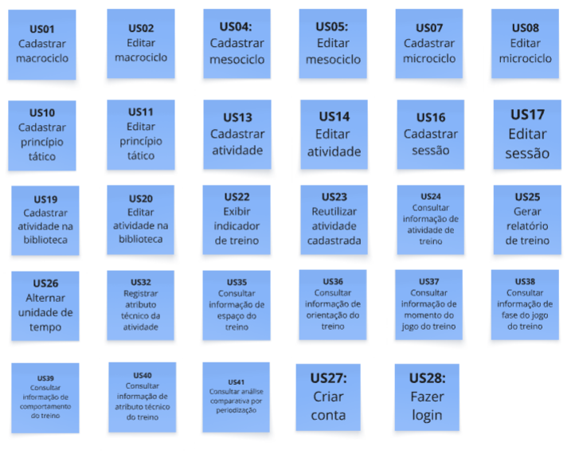

# Escopo do Produto

Esta seção descreve o Escopo de produto (preliminar ou completo, dependendo do produto), que é uma lista priorizada de todas as funcionalidades e melhorias planejadas para o software. Também aborda a priorização dessas funcionalidades e o que será entregue no Produto Mínimo Viável (MVP).

## 10.1 Priorização do Escopo Geral e MVP

Para priorizar o Escopo do FutBoard, cada requisito funcional (RF) recebeu cinco notas: **valor de negócio**, **frequência de uso**, **esforço**, **complexidade** e **conhecimento da equipe**. As três últimas foram combinadas em uma única medida, o **esforço técnico**, que foi cruzada com o valor de negócio para posicionar cada RF em um quadrante da matriz Valor x Esforço.

### 1. Critérios e legendas

#### 1.1 Valor de negócio

O valor de negócio foi definido a partir da justificativa dada pelo cliente para cada funcionalidade

| Nota | Nível de valor | Descrição |
|:---:|---|---|
| 4 | Muito Alto | O sistema necessita dessa funcionalidade. |
| 3 | Alto | Agrega muito valor ao produto e deve ser priorizado. |
| 2 | Moderado | Seria interessante ter, mas o sistema funciona perfeitamente sem.. |
| 1 | Baixo |Não faz sentido para o projeto neste momento |

#### 1.2 Frequencia de Uso
A frequencia de uso foi definida de acordo com a opinião do cliente levando em consideração o quão frequente será utilizado cada requisito.

| Pontuação | Interpretação | Descrição |
|:---:|---|---|
| 1 | Nunca | Em nenhum momento |
| 2 | Rara | Em situacoes especificas |
| 3 | Ocasionalmente | Mensalmente |
| 4 | Frequente | Semanalmente |
| 5 | Muito frequente | Diariamente |

#### 1.3 Esforço

| Pontuação | Interpretação | Descrição |
|:---:|---|---|
| 1 | Esforço baixo | Até 2 horas |
| 2 | Esforço moderado | Entre 2 e 6 horas |
| 3 | Esforço alto | Entre 6 e 12 horas |
| 4 | Esforço muito alto | Mais de 12 horas |

#### 1.4 Complexidade

| Pontuação | Interpretação |
|:---:|---|
| 1 | Operações cadastrais elementares (CRUD direto) em entidades isoladas, com validações de formato padronizadas, sem dependências de fluxo ou cálculos. Atividades com consumo de dados do banco. |
| 2 | Operações com dependência hierárquica (efeitos em cascata), integridade referencial estrita, upload de arquivos ou manipulação de coleções locais. |
| 3 | Lógica de negócio analítica, processamento em tempo de execução, cálculos derivados e reatividade/interdependência entre múltiplos componentes visuais. |
| 4 | Requisitos com alta incerteza técnica, algoritmos pesados de inferência/estatística ou dependência crítica de serviços/APIs externas de terceiros. |

#### 1.5 Conhecimento da equipe

| Pontuação | Interpretação |
|:---:|---|
| 1 | A equipe domina plenamente os conhecimentos necessários. |
| 2 | A equipe possui conhecimento suficiente, com pouca aprendizagem adicional. |
| 3 | A equipe precisa desenvolver conhecimentos relevantes. |
| 4 | A equipe ainda não possui os conhecimentos ou recursos necessários. |

### 2. Como as notas foram definidas: votação e média

As notas de esforço, complexidade e conhecimento da equipe não foram decididas por uma pessoa só. Para cada critério de cada requisito, todos os seis membros da equipe votaram individualmente, usando as legendas acima, e a nota final foi a **média dos votos**, arredondada para o inteiro mais próximo (valores com 0,5 sobem para o inteiro seguinte).

Exemplo de votação para um critério de um requisito:

| Membro | Voto |
|---|:---:|
| Giovana | 3 |
| Guilherme L. | 3 |
| Guilherme T. | 2 |
| Gustavo | 2 |
| Leonardo | 3 |
| Rafael | 2 |
| **Média** | **2,5 → 3** |

Cálculo: (3 + 3 + 2 + 2 + 3 + 2) / 6 = 2,5, arredondado para **3**.

### 3. Esforço técnico

O esforço técnico resume o custo de desenvolvimento de um RF em um único número, entre 1 e 4, calculado como a média simples das três notas finais:

```
Esforço técnico = (Esforço + Complexidade + Conhecimento da equipe) / 3
```

Exemplo com o RF31 (Gerar análise textual do treino): (3 + 4 + 4) / 3 = 3,67.

### 4. Matriz Valor x Esforço e quadrantes

Cada RF é posicionado em um quadrante comparando o **valor de negócio** com o **esforço técnico**, tendo 2 como ponto de corte nos dois eixos.

| Quadrante | Regra | Leitura | Prioridade sugerida |
|:---:|---|---|:---:|
| Q2 Alto valor / Baixa carga técnica | Valor > 2 e esforço técnico <= 2 | Alto valor / Baixa carga técnica | Prioridade 1 |
| Q1 Alto valor / Alta carga técnica | Valor > 2 e esforço técnico > 2 | Alto valor / Alta carga técnica | Prioridade 2 |
| Q3 Baixo valor / Baixa carga técnica | Valor <= 2 e esforço técnico <= 2 | Baixo valor / Baixa carga técnica | Prioridade 3 |
| Q4 Baixo valor / Alta carga técnica | Valor <= 2 e esforço técnico > 2 | Baixo valor / Alta carga técnica | Prioridade 4 |

A classificação foi automatizada na planilha com a fórmula abaixo, em que a coluna C guarda o valor de negócio e a coluna H o esforço técnico:

```excel
=MAP(C3:C500; H3:H500; LAMBDA(val; esf;
  SE(esf=""; "";
  IFS(
    (esf>2)*(val>2);   "Quadrante 1";
    (esf<=2)*(val>2);  "Quadrante 2";
    (esf<=2)*(val<=2); "Quadrante 3";
    (esf>2)*(val<=2);  "Quadrante 4"
  ))
))
``` 

## 10.2 Validação do Escopo e Escopo do MVP com o Cliente

Após a priorização preliminar do Escopo por meio da matriz Valor x Esforço e a consolidação dos requisitos nos quadrantes, a equipe realizou a **validação do Escopo e da delimitação do MVP diretamente com o cliente** (o técnico Marcus Vinicius).

Via Whatsapp, a equipe utilizou e encaminhou ao cliente a imagem **`MVPvalidado`** (armazenada na pasta `assets` e ilustrada a seguir), contendo a organização visual dos cartões de requisitos levantados para o MVP. [Acessar Validação do Cliente](validacao_cliente.md)

<figure markdown="span" style="text-align: center; margin: 1.5em 0;">
  { width="85%" style="border-radius: 6px; box-shadow: 0 4px 10px rgba(0,0,0,0.08);" }
  <figcaption>Figura: Evidência da validação do Escopo e escopo do MVP com o cliente via WhatsApp (artefato <code>MVPvalidado</code>)</figcaption>
</figure>
<details>
  <summary><strong>Explorar o Frame interativo do MVP validado</strong></summary>
<div style="position: relative; width: 100%; padding-top: 2.25%;">
  <iframe width="768" height="496" src="https://miro.com/app/live-embed/uXjVHolWByQ=/?focusWidget=3458764686717981053&embedMode=view_only_without_ui&embedId=274616413572" frameborder="0" scrolling="no" allow="fullscreen; clipboard-read; clipboard-write" allowfullscreen></iframe>
</div>
</details>
[Ou acesse a matriz no Miro](https://miro.com/welcomeonboard/YmN1NWlzM0VXeDkyTkhySndlQ3V3UTlqdmJlVDdDdnF1dmdjREpGVTdkb3RJeVptV20xYzlyTVJzd3hZNFpWdHFsVmNtMDQ5eGZIRm0rYzNCSnNybGhSYmFuVXJ3ZGdQZEkxSDRhZ3hjQ2RNK3A4TTZzNmVtUXdEVElpTjkyNFVyVmtkMG5hNDA3dVlncnBvRVB2ZXBnPT0hdjE=?share_link_id=122393869978)

Durante a validação via WhatsApp, o treinador Marcus Vinicius avaliou o quadro apresentado na imagem e confirmou que o conjunto de requisitos selecionado contempla com fidelidade as necessidades prioritárias para o MVP do FutBoard.


### 1. Justificativa para o MVP

A priorização do MVP baseou-se na matriz de Valor versus Esforço e na frequência de uso de cada funcionalidade. Selecionamos os requisitos dos quadrantes 1 e 2 que são de maior valor para o cliente e que apresentavam nível de uso de 3 a 5 (mensal, semanal e diário).

> O **RF01** foi marcado pelo cliente como **valor de negócio 4** e **frequência de uso de 2**, como estavámos selecionando os requisitos que estavam no quadrante 1 e 2 cuja a frequência de uso estava entre 3 e 5 esse requisito ficava de fora do MVP. Porém a equipe logo percebeu que o **RF01** é vital para o funcionamento do sistema. **Por isso o RF01 foi incorporado ao MVP.**

### 2. Análise de Dependências Estruturais (Inclusão do RF01)
A frequência de uso isoladamente não substitui a análise de dependências de arquitetura e domínio. O RF01 (Cadastrar macrociclo) possui Valor 4 e Frequência 2 (pois o macrociclo representa a temporada e é cadastrado poucas vezes ao ano), o que o deixaria fora de um filtro puramente mecânico por frequência. Contudo, na árvore hierárquica de periodização do sistema (Macrociclo → Mesociclo → Microciclo → Sessão → Atividades → Indicadores/Gráficos), o RF01 é pré-requisito estrutural obrigatório para RF04, RF07, RF16 e todas as consultas analíticas. Por essa dependência técnica direta, o RF01 foi incorporado ao MVP.

### 3. Inclusão do RF27 e do RF28 e permanência do RF29 fora do MVP

Na revisão da Unidade 3, a equipe identificou que o RF27 (Criar conta) e o RF28 (Fazer login) estavam classificados em Q4, embora tenham valor 3 e esforço técnico 2,33, o que pela regra da matriz corresponde a Q1. Com a classificação corrigida e frequência de uso 5, os dois passaram a atender aos critérios de corte e foram incluídos no MVP. Assim, o MVP reúne **29 RFs**: 26 RFs com valor 4 e frequência ≥ 3, o RF27, o RF28 e o RF01, incluído por dependência estrutural.

O **RF29** (Anexar imagem à atividade) também tem valor 3, está em Q2 e tem frequência 5, mas permanece fora do MVP: nenhum outro RF depende dele, ele não alimenta indicadores, gráficos nem o relatório, e exige armazenamento de arquivos, que só estará disponível com a implantação em VPS.

### 4. Por que estamos utilizando esses critérios?

- Contexto e desafio: Na avaliação inicial, aproximadamente 90% das funcionalidades foram avaliadas pelo cliente com valor de negócio máximo, gerando um escopo amplo demais para o MVP.

- Ajuste metodológico: Seguindo a orientação do professor, adicionamos a frequência de uso como segundo critério de corte.

- Resultado: O cruzamento entre valor e frequência permitiu priorizar o que era realmente essencial, reduzindo o escopo com validação e respaldo do cliente.

## 10.3 Histórico de Rastreabilidade

| Versão | Data | Descrição | Autor(es) | Artefato |
| :---: | :---: | :--- | :--- | :---: |
| `1.0` | 12/10/2026 | Versão consolidada referente à entrega da Unidade 02 | Rafael Wasconcelos | [Visualizar v1.0](https://mdsreq-fga-unb.github.io/REQ-2026.2-T01-FutBoard/Entrega-Unidade-02/visao-produto/Escopo_do_produto/) |
| `2.0` | 15/11/2026 | Atualização referente à entrega da Unidade 03 | Rafael Wasconcelos | **Versão Atual** |