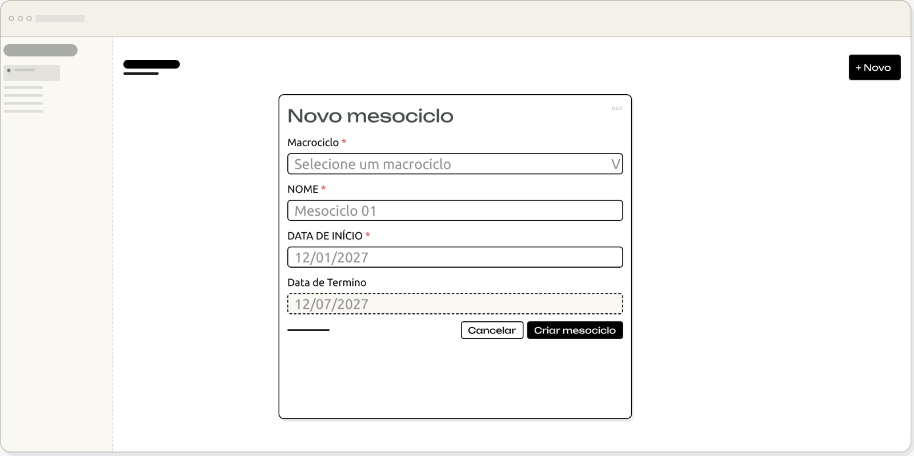
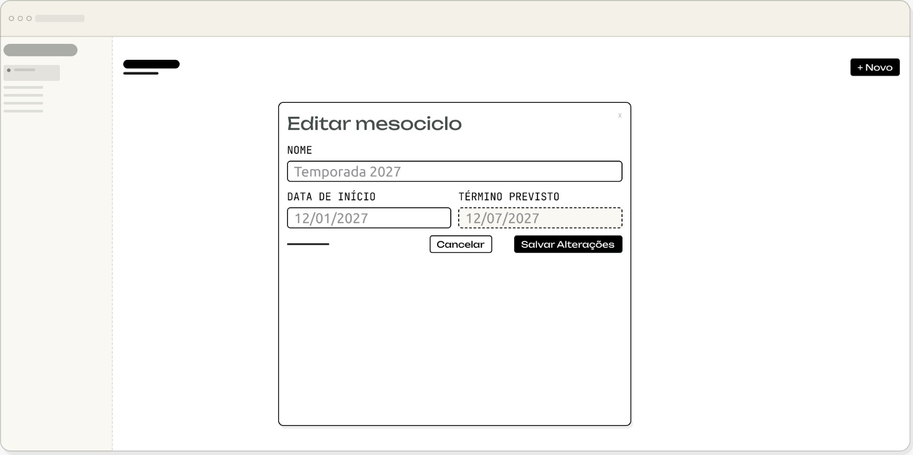
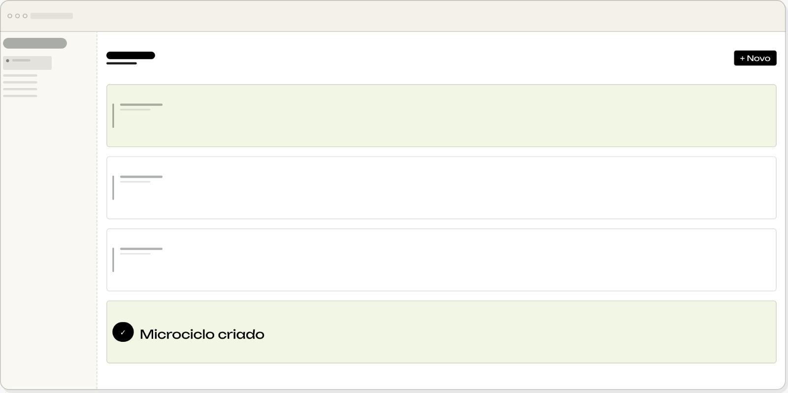

# Evidências — Iteração 7
**Período:** 19/10/2026 a 26/10/2026  
**Histórias trabalhadas:** [US01](../Requisitos-de-Software.md#rf01), [US02](../Requisitos-de-Software.md#rf02), [US04](../Requisitos-de-Software.md#rf04), [US05](../Requisitos-de-Software.md#rf05), [US07](../Requisitos-de-Software.md#rf07), [US08](../Requisitos-de-Software.md#rf08)

---

## Engenharia de Requisitos { #eng-requisitos }

### Gravações e Atas

| Evidência | Descrição |
| :--- | :--- |
| [Validação Cliente — US01](https://youtu.be/jytb0jdUH10) | Vídeo de validação da **US01** (Cadastrar macrociclo) com o cliente Marcus Vinicius. |
| [Validação Cliente — US02](https://youtu.be/UvoZ22L7Od0) | Vídeo de validação da **US02** (Editar macrociclo) com o cliente Marcus Vinicius. |
| [Validação Cliente — US04](https://youtu.be/Vrb2pxO-gQE) | Vídeo de validação da **US04** (Cadastrar mesociclo) com o cliente Marcus Vinicius. |
| *(Inserir link de validação — US05)* | Vídeo de validação da **US05** (Editar mesociclo) com o cliente Marcus Vinicius. |
| [Validação Cliente — US07](https://youtu.be/w4jOr4qmkJI) | Vídeo de validação da **US07** (Cadastrar microciclo) com o cliente Marcus Vinicius. |
| [Validação Cliente — US08](https://youtu.be/Iq24Y1mtWh4) | Vídeo de validação da **US08** (Editar microciclo) com o cliente Marcus Vinicius. |
| [Gravação 22/10 (Reunião Cliente 5)](../../atas-reunioes/reunioes-cliente.md#reuniao-com-o-cliente-5) | Apresentação e validação da estrutura de periodização (macrociclo, mesociclo e microciclo) junto ao cliente Marcus Vinicius, alinhando o fluxo em árvore e as datas variáveis dos ciclos. |
| [Ata 19/10 (Reunião Equipe 14)](../../atas-reunioes/reunioes-da-equipe.md#reuniao-da-equipe-14) | Divisão das histórias de usuário por iteração e organização da prototipação inicial de macro, meso e microciclo no Figma. |
| [Ata 26/10 (Reunião Equipe 15)](../../atas-reunioes/reunioes-da-equipe.md#reuniao-da-equipe-15) | Apresentação e revisão dos protótipos de baixa fidelidade da periodização e alinhamento das regras de negócio e fluxo de navegação. |

### Protótipos

=== "Baixa Fidelidade"

    === "US01"
        
        *Figura 1: Ação de criar macrociclo.*

        
        *Figura 2: Formulário de preenchimento do macrociclo.*

        
        *Figura 3: Listagem de macrociclos atualizada.*

    === "US02"
        
        *Figura 1: Seleção para edição do macrociclo.*

        
        *Figura 2: Formulário de edição dos dados do macrociclo.*

    === "US04"
        
        *Figura 1: Formulário de preenchimento do mesociclo.*

        
        *Figura 2: Listagem de mesociclos atualizada.*

    === "US05"
        
        *Figura 1: Seleção para edição do mesociclo.*

        
        *Figura 2: Formulário de edição dos dados do mesociclo.*

        
        *Figura 3: Listagem de mesociclos atualizada após edição.*

    === "US07"
        
        *Figura 1: Ação de cadastrar novo microciclo.*

        
        *Figura 2: Formulário de preenchimento do microciclo.*

        
        *Figura 3: Listagem de microciclos atualizada.*

    === "US08"
        
        *Figura 1: Seleção para edição do microciclo.*

        
        *Figura 2: Formulário de edição dos dados do microciclo.*

        
        *Figura 3: Listagem de microciclos atualizada após edição.*

---

## Definition of Done { #dod }

### Checklist da Iteração 7

| Critério do DoD | Evidência | Status |
| :--- | :--- | :---: |
| Os critérios de aceitação foram atendidos? | [Issue US01](#) [Issue US02](#) [Issue US04](#) [Issue US05](#) [Issue US07](#) [Issue US08](#) | [] |
| O código foi integrado na branch main e revisado? | *(Inserir link do Pull Request)* | [] |
| Os workflows de CI/CD do projeto foram executados com sucesso? | *(Inserir link do Workflow / GitHub Actions)* | [] |
| Os testes relacionados foram executados com sucesso? | *(Inserir link da execução dos testes unitários)* | [] |
| Os Requisitos Não Funcionais (RNFs) vinculados foram verificados? | *(Inserir print/vídeo da verificação de RNF02 — Responsividade em 360px, 768px e 1366px)* | [] |
| A verificação integrada dos fluxos foi realizada com sucesso? | *(Inserir captura de tela comprovando integridade hierárquica Macro ⊃ Meso ⊃ Micro — RN04)* | [] |
| A documentação e evidências da entrega estão atualizadas? | *(Inserir link do PR de atualização da documentação)* | [] |
| A funcionalidade da User Story desenvolvida foi validada pelo cliente? | [x] [Validação US01](https://youtu.be/jytb0jdUH10) [x] [Validação US02](https://youtu.be/UvoZ22L7Od0) [x] [Validação US04](https://youtu.be/Vrb2pxO-gQE) [] [Validação US05](#) [x] [Validação US07](https://youtu.be/w4jOr4qmkJI) [x] [Validação US08](https://youtu.be/Iq24Y1mtWh4) | [] |

