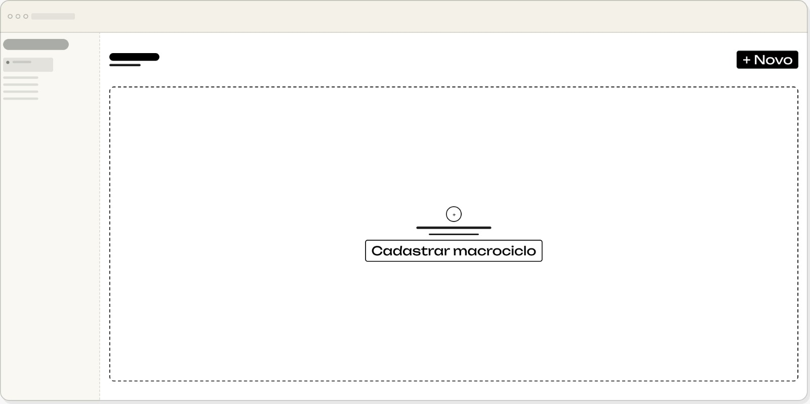
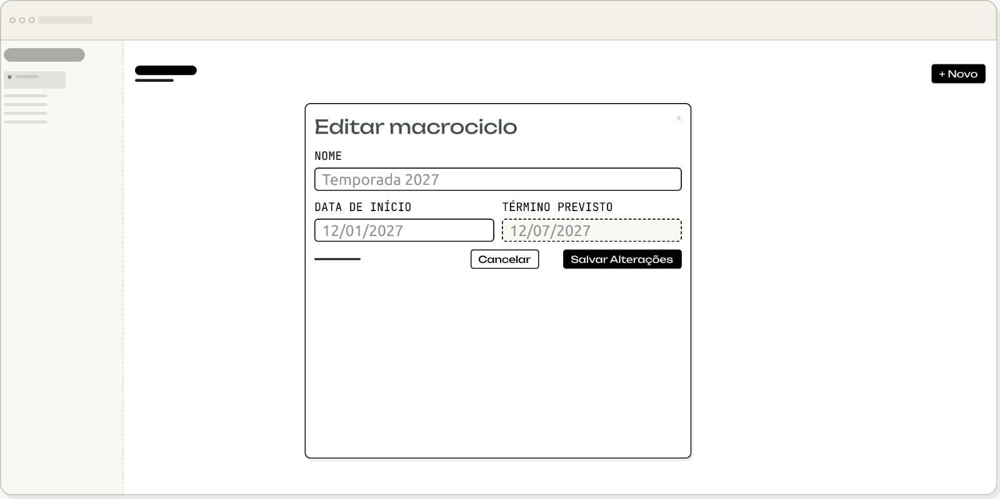
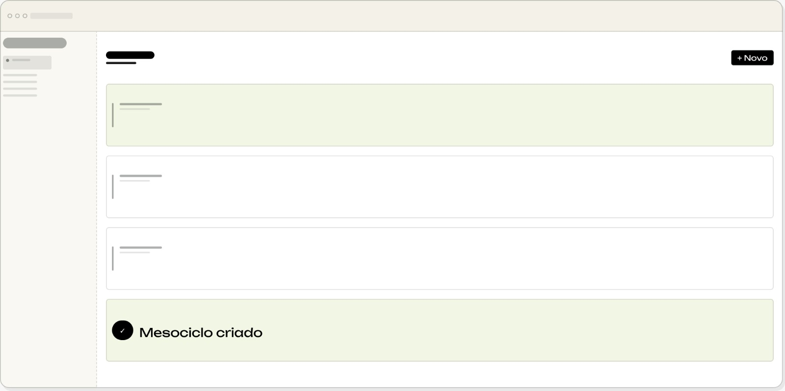
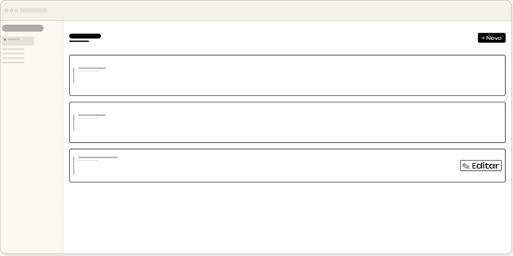
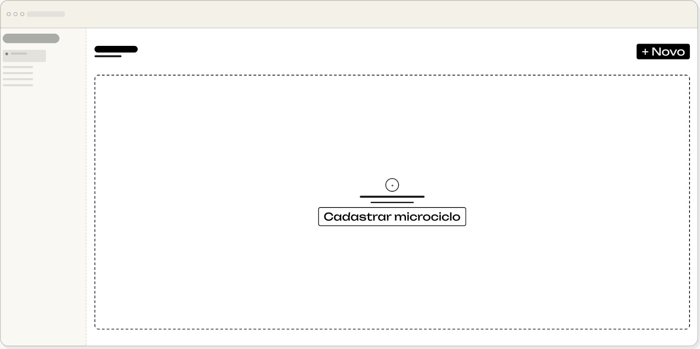
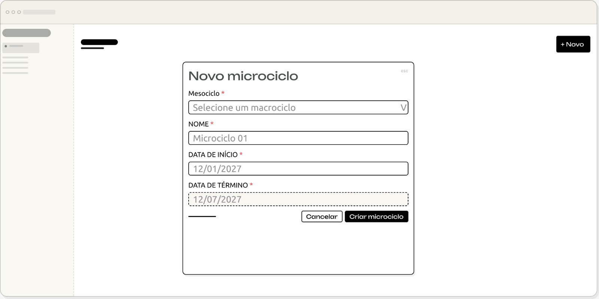
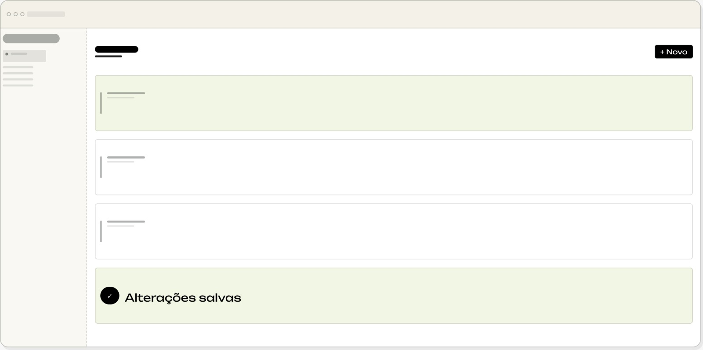

# Evidências — Iteração 7
**Período:** 19/10/2026 a 26/10/2026  
**Histórias trabalhadas:** [US01](../Requisitos-de-Software.md#rf01), [US02](../Requisitos-de-Software.md#rf02), [US04](../Requisitos-de-Software.md#rf04), [US05](../Requisitos-de-Software.md#rf05), [US07](../Requisitos-de-Software.md#rf07), [US08](../Requisitos-de-Software.md#rf08)

---

## Engenharia de Requisitos { #eng-requisitos }

### Gravações e Atas

| Evidência | Descrição |
| :--- | :--- |
| [Validação Cliente — US01](https://youtu.be/jytb0jdUH10) | Vídeo de validação da **US01** (Cadastrar macrociclo) com o cliente Marcus Vinicius. |
| [Validação Cliente — US02](https://youtu.be/UvoZ22L7Od0) | Vídeo de validação da **US02** (Editar macrociclo) com o cliente Marcus Vinicius. |
| [Validação Cliente — US04](https://youtu.be/Vrb2pxO-gQE) | Vídeo de validação da **US04** (Cadastrar mesociclo) com o cliente Marcus Vinicius. |
| [Print WhatsApp 28/10](../../assets/evidencias/whatsapp/whatsapp-2810-validacao-fluxo-arvore.png) | Validação da **US05** (Editar mesociclo) junto com o fluxo em árvore da periodização. |
| [Validação Cliente — US07](https://youtu.be/w4jOr4qmkJI) | Vídeo de validação da **US07** (Cadastrar microciclo) com o cliente Marcus Vinicius. |
| [Validação Cliente — US08](https://youtu.be/Iq24Y1mtWh4) | Vídeo de validação da **US08** (Editar microciclo) com o cliente Marcus Vinicius. |
| [Gravação 22/10 (Reunião Cliente 5)](../../atas-reunioes/reunioes-cliente.md#reuniao-com-o-cliente-5) | Apresentação e validação da estrutura de periodização (macrociclo, mesociclo e microciclo) junto ao cliente Marcus Vinicius, alinhando o fluxo em árvore e as datas variáveis dos ciclos. |
| [Ata 19/10 (Reunião Equipe 14)](../../atas-reunioes/reunioes-da-equipe.md#reuniao-da-equipe-14) | Divisão das histórias de usuário por iteração e organização da prototipação inicial de macro, meso e microciclo no Figma. |
| [Ata 26/10 (Reunião Equipe 15)](../../atas-reunioes/reunioes-da-equipe.md#reuniao-da-equipe-15) | Apresentação e revisão dos protótipos de baixa fidelidade da periodização e alinhamento das regras de negócio e fluxo de navegação. |
| [Print WhatsApp 27/10](../../assets/evidencias/whatsapp/whatsapp-2710-fluxo-arvore.png) | Vídeo do fluxo em árvore (macrociclo → mesociclo → microciclo) enviado ao cliente para validação das **US01, US02, US04, US05, US07 e US08**. |
| [Print WhatsApp 28/10](../../assets/evidencias/whatsapp/whatsapp-2810-validacao-fluxo-arvore.png) | O cliente valida o fluxo em árvore ("Isso mesmo"). |

### Protótipos

=== "Baixa Fidelidade"

    === "US01"
        
        *Figura 1: Ação de criar macrociclo.*

        
        *Figura 2: Formulário de preenchimento do macrociclo.*

        
        *Figura 3: Listagem de macrociclos atualizada.*

    === "US02"
        
        *Figura 1: Seleção para edição do macrociclo.*

        
        *Figura 2: Formulário de edição dos dados do macrociclo.*

    === "US04"
        
        *Figura 1: Formulário de preenchimento do mesociclo.*

        
        *Figura 2: Listagem de mesociclos atualizada.*

    === "US05"
        
        *Figura 1: Seleção para edição do mesociclo.*

        
        *Figura 2: Formulário de edição dos dados do mesociclo.*

        
        *Figura 3: Listagem de mesociclos atualizada após edição.*

    === "US07"
        
        *Figura 1: Ação de cadastrar novo microciclo.*

        
        *Figura 2: Formulário de preenchimento do microciclo.*

        
        *Figura 3: Listagem de microciclos atualizada.*

    === "US08"
        
        *Figura 1: Seleção para edição do microciclo.*

        
        *Figura 2: Formulário de edição dos dados do microciclo.*

        
        *Figura 3: Listagem de microciclos atualizada após edição.*

### Confronto Cruzado { #confronto-cruzado }

| História | Item declarado | Evidência no protótipo | Status |
| :--- | :--- | :--- | :---: |
| **US01** | Cadastro com nome, data de início e data de fim obrigatórios (CA) | [Formulário](https://www.figma.com/design/BDeb0IKSdM2vWSrp9FaePu/FutBoard?node-id=35-214) | [x] |
| **US01** | Alerta quando campos obrigatórios não são preenchidos (CA) | Ausente: nenhum frame mostra o alerta | [] |
| **US01** | Alerta quando a data de fim é anterior à de início (CA) | Ausente: nenhum frame mostra o alerta | [] |
| **US01** | Estado vazio antes do primeiro cadastro (DoR) | [Estado vazio](https://www.figma.com/design/BDeb0IKSdM2vWSrp9FaePu/FutBoard?node-id=35-179) | [x] |
| **US01** | Macrociclo como raiz da árvore (RN04) | [Lista atualizada](https://www.figma.com/design/BDeb0IKSdM2vWSrp9FaePu/FutBoard?node-id=36-276) | [x] |
| **US01** | Data de fim na declaração da US01 | Divergente: o protótipo tem a data de fim, mas a US01 pede só nome e data de início (D02) | [] |
| **US02** | Dados atualizados na visualização após a edição (CA) | Ausente: nenhum frame mostra a lista atualizada | [] |
| **US02** | Bloqueio de data de fim anterior à de início (CA) | Ausente: nenhum frame mostra o alerta | [] |
| **US02** | Edição sem quebrar a hierarquia dos ciclos filhos (CA, RN04) | Ausente: nenhum frame mostra o alerta | [] |
| **US02** | Data de término obrigatória (CA) | Divergente: o [formulário de edição](https://www.figma.com/design/BDeb0IKSdM2vWSrp9FaePu/FutBoard?node-id=38-2) usa "Término previsto" sem asterisco | [] |
| **US04** | Cadastro com nome, datas e vínculo a um macrociclo (CA, RN04) | [Formulário](https://www.figma.com/design/BDeb0IKSdM2vWSrp9FaePu/FutBoard?node-id=159-2) | [x] |
| **US04** | Data de término obrigatória (CA) | Divergente: o [formulário](https://www.figma.com/design/BDeb0IKSdM2vWSrp9FaePu/FutBoard?node-id=159-2) não marca o campo como obrigatório | [] |
| **US04** | Alerta quando não há macrociclo (CA) | Ausente: nenhum frame mostra o alerta | [] |
| **US04** | Estado vazio de mesociclos (DoR) | Ausente: nenhum frame mostra o estado vazio | [] |
| **US05** | Atualização mantendo posição e vínculos na árvore (CA) | [Lista atualizada](https://www.figma.com/design/BDeb0IKSdM2vWSrp9FaePu/FutBoard?node-id=159-184) | [x] |
| **US05** | Edição não desvincula o mesociclo do macrociclo (CA, RN04) | [Formulário de edição](https://www.figma.com/design/BDeb0IKSdM2vWSrp9FaePu/FutBoard?node-id=159-141) | [x] |
| **US05** | Exemplo do campo Nome | Divergente: o [formulário de edição](https://www.figma.com/design/BDeb0IKSdM2vWSrp9FaePu/FutBoard?node-id=159-141) usa "Temporada 2027", exemplo de macrociclo | [] |
| **US07** | Cadastro com nome, datas e seleção de mesociclo (CA, RN04) | [Formulário](https://www.figma.com/design/BDeb0IKSdM2vWSrp9FaePu/FutBoard?node-id=84-33) | [x] |
| **US07** | Alerta quando não há mesociclo (CA) | Ausente: nenhum frame mostra o alerta | [] |
| **US07** | Alerta quando campos obrigatórios não são preenchidos (CA) | Ausente: nenhum frame mostra o alerta | [] |
| **US07** | Seleção do mesociclo | Divergente: o [formulário](https://www.figma.com/design/BDeb0IKSdM2vWSrp9FaePu/FutBoard?node-id=84-33) diz "Selecione um macrociclo" | [] |
| **US07** | Estado vazio antes do primeiro cadastro (DoR) | [Estado vazio](https://www.figma.com/design/BDeb0IKSdM2vWSrp9FaePu/FutBoard?node-id=84-2) | [x] |
| **US08** | Atualização sem desconectar as sessões vinculadas (CA, RN04) | [Lista atualizada](https://www.figma.com/design/BDeb0IKSdM2vWSrp9FaePu/FutBoard?node-id=159-270) | [x] |
| **US08** | Campos obrigatórios marcados (CA) | [Formulário de edição](https://www.figma.com/design/BDeb0IKSdM2vWSrp9FaePu/FutBoard?node-id=159-314) | [x] |

**Resultado:** 10 itens conferidos e 14 com pendência (5 divergentes e 9 ausentes). As correções estão na decisão D03.

### Registro de Decisões e Matriz de Impacto { #registro-de-decisoes }

| ID | Decisão | Evidência | Impacto nos artefatos | Status |
| :---: | :--- | :--- | :--- | :---: |
| D01 | **22/10** — Cadastro da periodização em árvore: macrociclo, depois mesociclo, depois microciclo. | [Reunião com o cliente 5](../../atas-reunioes/reunioes-cliente.md#reuniao-com-o-cliente-5) [Print WhatsApp 28/10](../../assets/evidencias/whatsapp/whatsapp-2810-validacao-fluxo-arvore.png) | Atualizados: critérios, RN04, protótipo e documentação. A verificar: código. | [] |
| D02 | **22/10** — Macro, meso e microciclo com data de início e data de fim obrigatórias. | [Reunião com o cliente 5](../../atas-reunioes/reunioes-cliente.md#reuniao-com-o-cliente-5) | Atualizados: RF01, RF04, RF07, critérios, protótipo, código e documentação. Pendente: US01. | [] |
| D03 | **16/11** — Corrigir nos protótipos as pendências do confronto cruzado. | [Confronto cruzado](#confronto-cruzado) | Pendentes: protótipos e US01. | [] |

---

## Definition of Done { #dod }

### Checklist da Iteração 7

| Critério do DoD | Evidência | Status |
| :--- | :--- | :---: |
| Os critérios de aceitação foram atendidos? | [Issue US01](https://github.com/mdsreq-fga-unb/REQ-2026.2-T01-FutBoard/issues/23) [Issue US02](https://github.com/mdsreq-fga-unb/REQ-2026.2-T01-FutBoard/issues/23) [Issue US04](https://github.com/mdsreq-fga-unb/REQ-2026.2-T01-FutBoard/issues/28) [Issue US05](https://github.com/mdsreq-fga-unb/REQ-2026.2-T01-FutBoard/issues/29) [Issue US07](https://github.com/mdsreq-fga-unb/REQ-2026.2-T01-FutBoard/issues/30) [Issue US08](https://github.com/mdsreq-fga-unb/REQ-2026.2-T01-FutBoard/issues/31) | [] |
| O código foi integrado na branch main e revisado? | [PR #22](https://github.com/mdsreq-fga-unb/REQ-2026.2-T01-FutBoard/pull/22) (US01, US02) · [PR #49](https://github.com/mdsreq-fga-unb/REQ-2026.2-T01-FutBoard/pull/49) (US04, US05) · [PR #25](https://github.com/mdsreq-fga-unb/REQ-2026.2-T01-FutBoard/pull/25) (US07, US08), integrados na `staging`. | [] |
| Os workflows de CI/CD do projeto foram executados com sucesso? | O repositório tem apenas o workflow de deploy da documentação ([deploy.yml](https://github.com/mdsreq-fga-unb/REQ-2026.2-T01-FutBoard/blob/main/.github/workflows/deploy.yml)); não há workflow de CI para o código. | [] |
| Os testes relacionados foram executados com sucesso? | Testes unitários do backend em [`apps/ciclos/tests.py`](https://github.com/mdsreq-fga-unb/REQ-2026.2-T01-FutBoard/blob/staging/backend/apps/ciclos/tests.py) (15 testes), sem registro de execução publicado. O frontend não tem testes. | [] |
| Os Requisitos Não Funcionais (RNFs) vinculados foram verificados? | Pendente: verificação ainda não registrada. | [] |
| A verificação integrada dos fluxos foi realizada com sucesso? | Pendente: verificação ainda não registrada. | [] |
| A documentação e evidências da entrega estão atualizadas? | Esta página de evidências, atualizada em 16/11/2026. | [] |
| A funcionalidade da User Story desenvolvida foi validada pelo cliente? | [x] [Validação US01](https://youtu.be/jytb0jdUH10) [x] [Validação US02](https://youtu.be/UvoZ22L7Od0) [x] [Validação US04](https://youtu.be/Vrb2pxO-gQE) [] [Protótipo validado — US05](../../assets/evidencias/whatsapp/whatsapp-2810-validacao-fluxo-arvore.png) [x] [Validação US07](https://youtu.be/w4jOr4qmkJI) [x] [Validação US08](https://youtu.be/Iq24Y1mtWh4) | [] |

