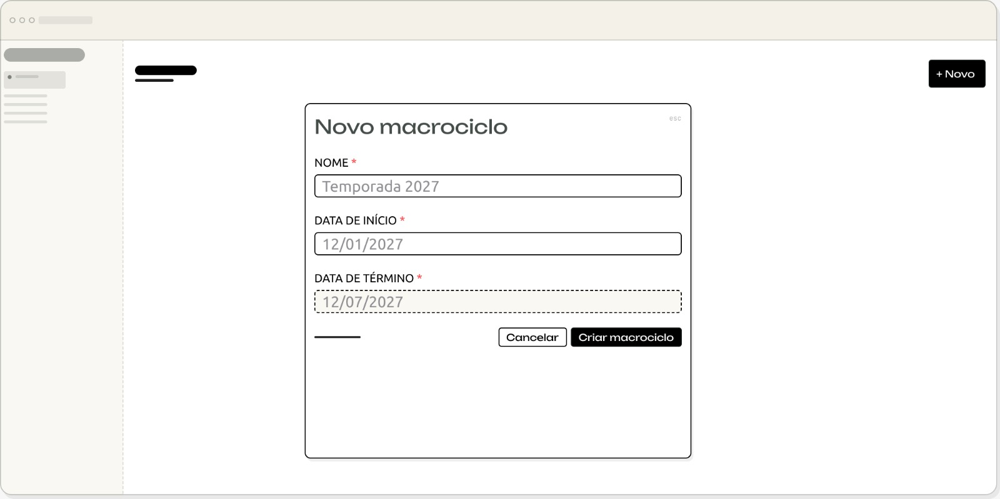
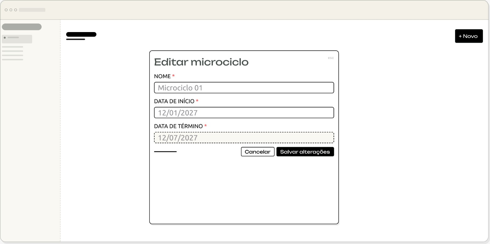

# Evidências — Iteração 7
**Período:** 19/10/2026 a 26/10/2026  
**Histórias trabalhadas:** [US01](../Requisitos-de-Software.md#rf01), [US02](../Requisitos-de-Software.md#rf02), [US04](../Requisitos-de-Software.md#rf04), [US05](../Requisitos-de-Software.md#rf05), [US07](../Requisitos-de-Software.md#rf07), [US08](../Requisitos-de-Software.md#rf08)

---

## Engenharia de Requisitos { #eng-requisitos }

### Gravações e Atas

| Evidência | Descrição |
| :--- | :--- |
| [Validação Cliente — US01](https://youtu.be/jytb0jdUH10) | Vídeo de validação da **US01** (Cadastrar macrociclo) com o cliente Marcus Vinicius. |
| [Validação Cliente — US02](https://youtu.be/UvoZ22L7Od0) | Vídeo de validação da **US02** (Editar macrociclo) com o cliente Marcus Vinicius. |
| [Validação Cliente — US04](https://youtu.be/Vrb2pxO-gQE) | Vídeo de validação da **US04** (Cadastrar mesociclo) com o cliente Marcus Vinicius. |
| [Validação Cliente — US05](https://youtu.be/lUtvgRjILr8) | Vídeo de validação da **US05** (Editar mesociclo)  com o cliente Marcus Vinicius. |
| [Validação Cliente — US07](https://youtu.be/w4jOr4qmkJI) | Vídeo de validação da **US07** (Cadastrar microciclo) com o cliente Marcus Vinicius. |
| [Validação Cliente — US08](https://youtu.be/Iq24Y1mtWh4) | Vídeo de validação da **US08** (Editar microciclo) com o cliente Marcus Vinicius. |
| [Gravação 22/10 (Reunião Cliente 5)](../../atas-reunioes/reunioes-cliente.md#reuniao-com-o-cliente-5) | Apresentação e validação da estrutura de periodização (macrociclo, mesociclo e microciclo) junto ao cliente Marcus Vinicius, alinhando o fluxo em árvore e as datas variáveis dos ciclos. |
| [Ata 19/10 (Reunião Equipe 14)](../../atas-reunioes/reunioes-da-equipe.md#reuniao-da-equipe-14) | Divisão das histórias de usuário por iteração e organização da prototipação inicial de macro, meso e microciclo no Figma. |
| [Ata 26/10 (Reunião Equipe 15)](../../atas-reunioes/reunioes-da-equipe.md#reuniao-da-equipe-15) | Apresentação e revisão dos protótipos de baixa fidelidade da periodização e alinhamento das regras de negócio e fluxo de navegação. |
| [Print WhatsApp 27/10](../../assets/evidencias/whatsapp/whatsapp-2710-fluxo-arvore.png) | Vídeo do fluxo em árvore (macrociclo → mesociclo → microciclo) enviado ao cliente para validação das **US01, US02, US04, US05, US07 e US08**. |
| [Print WhatsApp 28/10](../../assets/evidencias/whatsapp/whatsapp-2810-validacao-fluxo-arvore.png) | O cliente valida o fluxo em árvore ("Isso mesmo"). |

### Protótipos

=== "Baixa Fidelidade"

    === "US01"
        
        *Figura 1: Ação de criar macrociclo.*

        
        *Figura 2: Formulário de preenchimento do macrociclo.*

        
        *Figura 3: Listagem de macrociclos atualizada.*

    === "US02"
        
        *Figura 1: Seleção para edição do macrociclo.*

        
        *Figura 2: Formulário de edição dos dados do macrociclo.*

    === "US04"
        
        *Figura 1: Formulário de preenchimento do mesociclo.*

        
        *Figura 2: Listagem de mesociclos atualizada.*

    === "US05"
        
        *Figura 1: Seleção para edição do mesociclo.*

        
        *Figura 2: Formulário de edição dos dados do mesociclo.*

        
        *Figura 3: Listagem de mesociclos atualizada após edição.*

    === "US07"
        
        *Figura 1: Ação de cadastrar novo microciclo.*

        
        *Figura 2: Formulário de preenchimento do microciclo.*

        
        *Figura 3: Listagem de microciclos atualizada.*

    === "US08"
        
        *Figura 1: Seleção para edição do microciclo.*

        
        *Figura 2: Formulário de edição dos dados do microciclo.*

        
        *Figura 3: Listagem de microciclos atualizada após edição.*

### Registro de Decisões e Matriz de Impacto { #registro-de-decisoes }

| ID | Decisão | Evidência | Impacto nos artefatos | Status |
| :---: | :--- | :--- | :--- | :---: |
| D01 | **22/10** — Cadastro da periodização em árvore: macrociclo, depois mesociclo, depois microciclo. | [Reunião com o cliente 5](../../atas-reunioes/reunioes-cliente.md#reuniao-com-o-cliente-5) [Print WhatsApp 28/10](../../assets/evidencias/whatsapp/whatsapp-2810-validacao-fluxo-arvore.png) | Atualizados: critérios, RN04, protótipo e documentação. A verificar: código. | [] |
| D02 | **22/10** — Macro, meso e microciclo com data de início e data de fim obrigatórias. | [Reunião com o cliente 5](../../atas-reunioes/reunioes-cliente.md#reuniao-com-o-cliente-5) | Atualizados: RF01, RF04, RF07, critérios, protótipo, código e documentação. Pendente: US01. | [] |
| D03 | **16/11** — Corrigir nos protótipos as pendências do confronto cruzado. | [Confronto cruzado](#confronto-cruzado) | Pendentes: protótipos e US01. | [] |

---

## Definition of Done { #dod }

### Checklist por História — Iteração 7

=== "US01"

    | Critério do DoD | Evidência | Status |
    | :--- | :--- | :---: |
    | Os critérios de aceitação foram atendidos? | [Issue US01](https://github.com/mdsreq-fga-unb/REQ-2026.2-T01-FutBoard/issues/23) | [] |
    | O código foi integrado na branch main e revisado? | [PR #22](https://github.com/mdsreq-fga-unb/REQ-2026.2-T01-FutBoard/pull/22), integrado na `staging` (pendente integração na `main`). | [] |
    | Os workflows de CI/CD do projeto foram executados com sucesso? | O repositório tem apenas o workflow de deploy da documentação ([deploy.yml](https://github.com/mdsreq-fga-unb/REQ-2026.2-T01-FutBoard/blob/main/.github/workflows/deploy.yml)); não há workflow de CI para o código na `main`. | [] |
    | Os testes relacionados foram executados com sucesso? | Testes unitários do backend em [`apps/ciclos/tests.py`](https://github.com/mdsreq-fga-unb/REQ-2026.2-T01-FutBoard/blob/staging/backend/apps/ciclos/tests.py), sem registro de execução publicado. O frontend não tem testes. | [] |
    | Os Requisitos Não Funcionais (RNFs) vinculados foram verificados? | Pendente: verificação ainda não registrada (RNF02, RNF04). | [] |
    | A verificação integrada dos fluxos foi realizada com sucesso? | Pendente: verificação ainda não registrada. | [] |
    | A documentação e evidências da entrega estão atualizadas? | Esta página de evidências, atualizada em 16/11/2026. | [] |
    | A funcionalidade da User Story desenvolvida foi validada pelo cliente? | [Validação US01](https://youtu.be/jytb0jdUH10) | [x] |

=== "US02"

    | Critério do DoD | Evidência | Status |
    | :--- | :--- | :---: |
    | Os critérios de aceitação foram atendidos? | [Issue US02](https://github.com/mdsreq-fga-unb/REQ-2026.2-T01-FutBoard/issues/23) | [] |
    | O código foi integrado na branch main e revisado? | [PR #22](https://github.com/mdsreq-fga-unb/REQ-2026.2-T01-FutBoard/pull/22), integrado na `staging` (pendente integração na `main`). | [] |
    | Os workflows de CI/CD do projeto foram executados com sucesso? | O repositório tem apenas o workflow de deploy da documentação ([deploy.yml](https://github.com/mdsreq-fga-unb/REQ-2026.2-T01-FutBoard/blob/main/.github/workflows/deploy.yml)); não há workflow de CI para o código na `main`. | [] |
    | Os testes relacionados foram executados com sucesso? | Testes unitários do backend em [`apps/ciclos/tests.py`](https://github.com/mdsreq-fga-unb/REQ-2026.2-T01-FutBoard/blob/staging/backend/apps/ciclos/tests.py), sem registro de execução publicado. O frontend não tem testes. | [] |
    | Os Requisitos Não Funcionais (RNFs) vinculados foram verificados? | Pendente: verificação ainda não registrada (RNF02, RNF04). | [] |
    | A verificação integrada dos fluxos foi realizada com sucesso? | Pendente: verificação ainda não registrada. | [] |
    | A documentação e evidências da entrega estão atualizadas? | Esta página de evidências, atualizada em 16/11/2026. | [] |
    | A funcionalidade da User Story desenvolvida foi validada pelo cliente? | [Validação US02](https://youtu.be/UvoZ22L7Od0) | [x] |

=== "US04"

    | Critério do DoD | Evidência | Status |
    | :--- | :--- | :---: |
    | Os critérios de aceitação foram atendidos? | [Issue US04](https://github.com/mdsreq-fga-unb/REQ-2026.2-T01-FutBoard/issues/28) | [] |
    | O código foi integrado na branch main e revisado? | [PR #49](https://github.com/mdsreq-fga-unb/REQ-2026.2-T01-FutBoard/pull/49), integrado na `staging` (pendente integração na `main`). | [] |
    | Os workflows de CI/CD do projeto foram executados com sucesso? | O repositório tem apenas o workflow de deploy da documentação ([deploy.yml](https://github.com/mdsreq-fga-unb/REQ-2026.2-T01-FutBoard/blob/main/.github/workflows/deploy.yml)); não há workflow de CI para o código na `main`. | [] |
    | Os testes relacionados foram executados com sucesso? | Testes unitários do backend em [`apps/ciclos/tests.py`](https://github.com/mdsreq-fga-unb/REQ-2026.2-T01-FutBoard/blob/staging/backend/apps/ciclos/tests.py), sem registro de execução publicado. O frontend não tem testes. | [] |
    | Os Requisitos Não Funcionais (RNFs) vinculados foram verificados? | Pendente: verificação ainda não registrada (RNF02, RNF04). | [] |
    | A verificação integrada dos fluxos foi realizada com sucesso? | Pendente: verificação ainda não registrada. | [] |
    | A documentação e evidências da entrega estão atualizadas? | Esta página de evidências, atualizada em 16/11/2026. | [] |
    | A funcionalidade da User Story desenvolvida foi validada pelo cliente? | [Validação US04](https://youtu.be/Vrb2pxO-gQE) | [x] |

=== "US05"

    | Critério do DoD | Evidência | Status |
    | :--- | :--- | :---: |
    | Os critérios de aceitação foram atendidos? | [Issue US05](https://github.com/mdsreq-fga-unb/REQ-2026.2-T01-FutBoard/issues/29) | [] |
    | O código foi integrado na branch main e revisado? | [PR #49](https://github.com/mdsreq-fga-unb/REQ-2026.2-T01-FutBoard/pull/49), integrado na `staging` (pendente integração na `main`). | [] |
    | Os workflows de CI/CD do projeto foram executados com sucesso? | O repositório tem apenas o workflow de deploy da documentação ([deploy.yml](https://github.com/mdsreq-fga-unb/REQ-2026.2-T01-FutBoard/blob/main/.github/workflows/deploy.yml)); não há workflow de CI para o código na `main`. | [] |
    | Os testes relacionados foram executados com sucesso? | Testes unitários do backend em [`apps/ciclos/tests.py`](https://github.com/mdsreq-fga-unb/REQ-2026.2-T01-FutBoard/blob/staging/backend/apps/ciclos/tests.py), sem registro de execução publicado. O frontend não tem testes. | [] |
    | Os Requisitos Não Funcionais (RNFs) vinculados foram verificados? | Pendente: verificação ainda não registrada (RNF02, RNF04). | [] |
    | A verificação integrada dos fluxos foi realizada com sucesso? | Pendente: verificação ainda não registrada. | [] |
    | A documentação e evidências da entrega estão atualizadas? | Esta página de evidências, atualizada em 16/11/2026. | [] |
    | A funcionalidade da User Story desenvolvida foi validada pelo cliente? | Pendente validação da funcionalidade implementada. [Protótipo validado — US05](../../assets/evidencias/whatsapp/whatsapp-2810-validacao-fluxo-arvore.png) | [] |

=== "US07"

    | Critério do DoD | Evidência | Status |
    | :--- | :--- | :---: |
    | Os critérios de aceitação foram atendidos? | [Issue US07](https://github.com/mdsreq-fga-unb/REQ-2026.2-T01-FutBoard/issues/30) | [] |
    | O código foi integrado na branch main e revisado? | [PR #25](https://github.com/mdsreq-fga-unb/REQ-2026.2-T01-FutBoard/pull/25), integrado na `staging` (pendente integração na `main`). | [] |
    | Os workflows de CI/CD do projeto foram executados com sucesso? | O repositório tem apenas o workflow de deploy da documentação ([deploy.yml](https://github.com/mdsreq-fga-unb/REQ-2026.2-T01-FutBoard/blob/main/.github/workflows/deploy.yml)); não há workflow de CI para o código na `main`. | [] |
    | Os testes relacionados foram executados com sucesso? | Testes unitários do backend em [`apps/ciclos/tests.py`](https://github.com/mdsreq-fga-unb/REQ-2026.2-T01-FutBoard/blob/staging/backend/apps/ciclos/tests.py), sem registro de execução publicado. O frontend não tem testes. | [] |
    | Os Requisitos Não Funcionais (RNFs) vinculados foram verificados? | Pendente: verificação ainda não registrada (RNF02, RNF04). | [] |
    | A verificação integrada dos fluxos foi realizada com sucesso? | Pendente: verificação ainda não registrada. | [] |
    | A documentação e evidências da entrega estão atualizadas? | Esta página de evidências, atualizada em 16/11/2026. | [] |
    | A funcionalidade da User Story desenvolvida foi validada pelo cliente? | [Validação US07](https://youtu.be/w4jOr4qmkJI) | [x] |

=== "US08"

    | Critério do DoD | Evidência | Status |
    | :--- | :--- | :---: |
    | Os critérios de aceitação foram atendidos? | [Issue US08](https://github.com/mdsreq-fga-unb/REQ-2026.2-T01-FutBoard/issues/31) | [] |
    | O código foi integrado na branch main e revisado? | [PR #25](https://github.com/mdsreq-fga-unb/REQ-2026.2-T01-FutBoard/pull/25), integrado na `staging` (pendente integração na `main`). | [] |
    | Os workflows de CI/CD do projeto foram executados com sucesso? | O repositório tem apenas o workflow de deploy da documentação ([deploy.yml](https://github.com/mdsreq-fga-unb/REQ-2026.2-T01-FutBoard/blob/main/.github/workflows/deploy.yml)); não há workflow de CI para o código na `main`. | [] |
    | Os testes relacionados foram executados com sucesso? | Testes unitários do backend em [`apps/ciclos/tests.py`](https://github.com/mdsreq-fga-unb/REQ-2026.2-T01-FutBoard/blob/staging/backend/apps/ciclos/tests.py), sem registro de execução publicado. O frontend não tem testes. | [] |
    | Os Requisitos Não Funcionais (RNFs) vinculados foram verificados? | Pendente: verificação ainda não registrada (RNF02, RNF04). | [] |
    | A verificação integrada dos fluxos foi realizada com sucesso? | Pendente: verificação ainda não registrada. | [] |
    | A documentação e evidências da entrega estão atualizadas? | Esta página de evidências, atualizada em 16/11/2026. | [] |
    | A funcionalidade da User Story desenvolvida foi validada pelo cliente? | [Validação US08](https://youtu.be/Iq24Y1mtWh4) | [x] |

