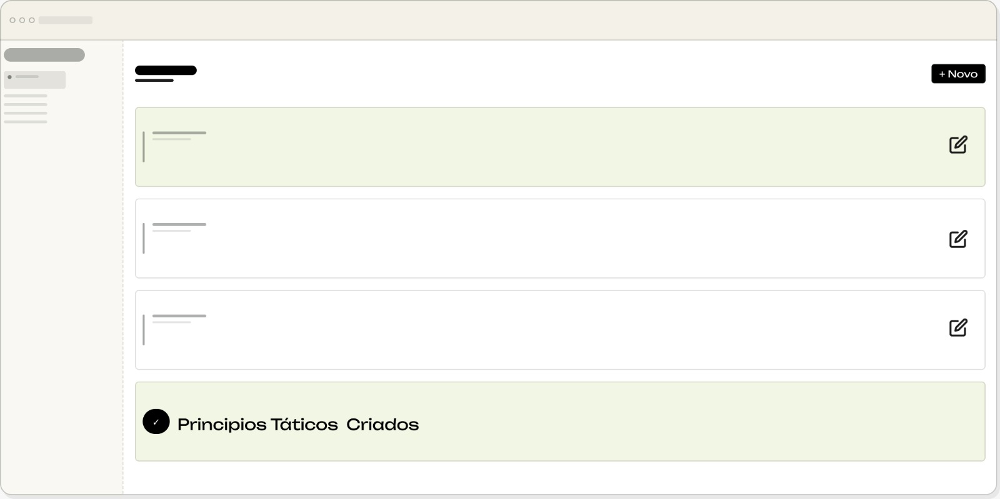
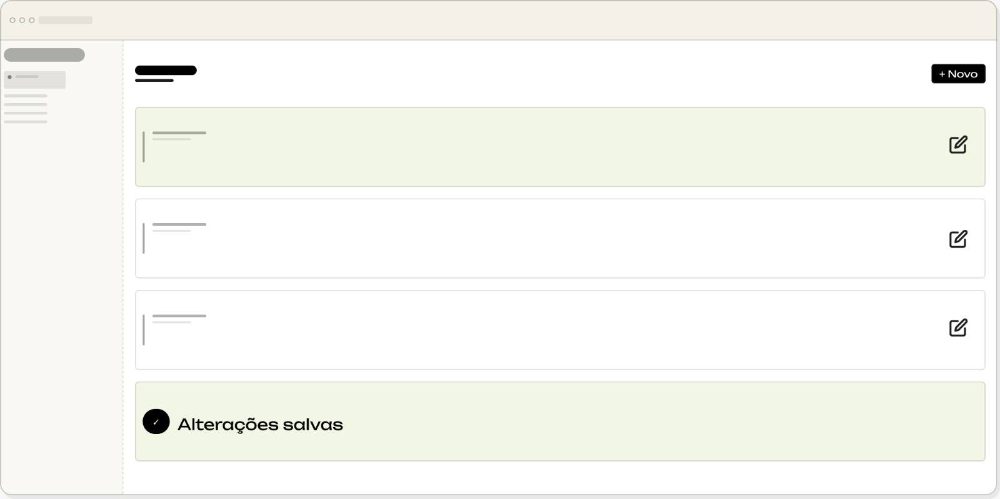
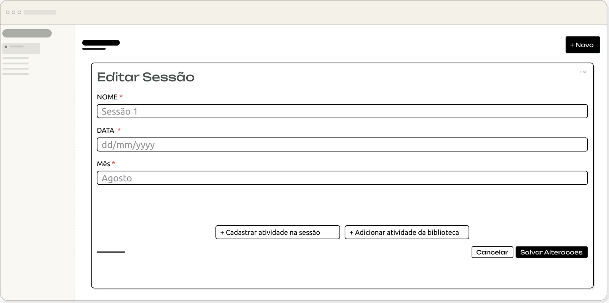
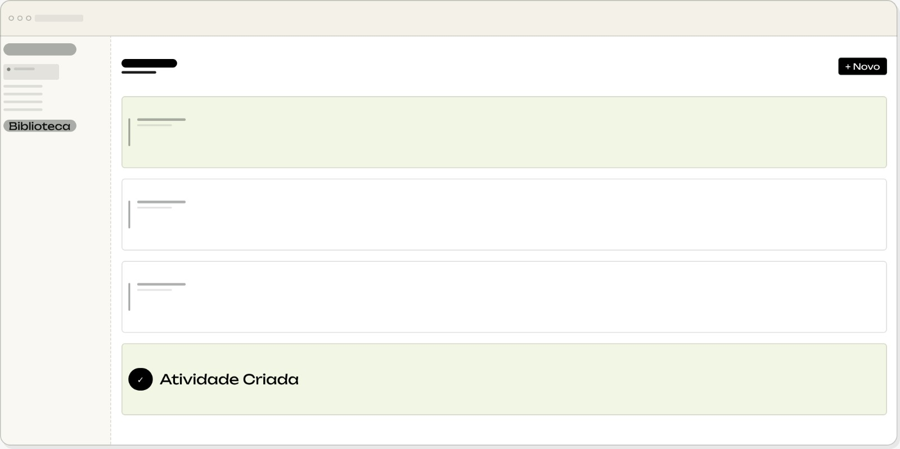
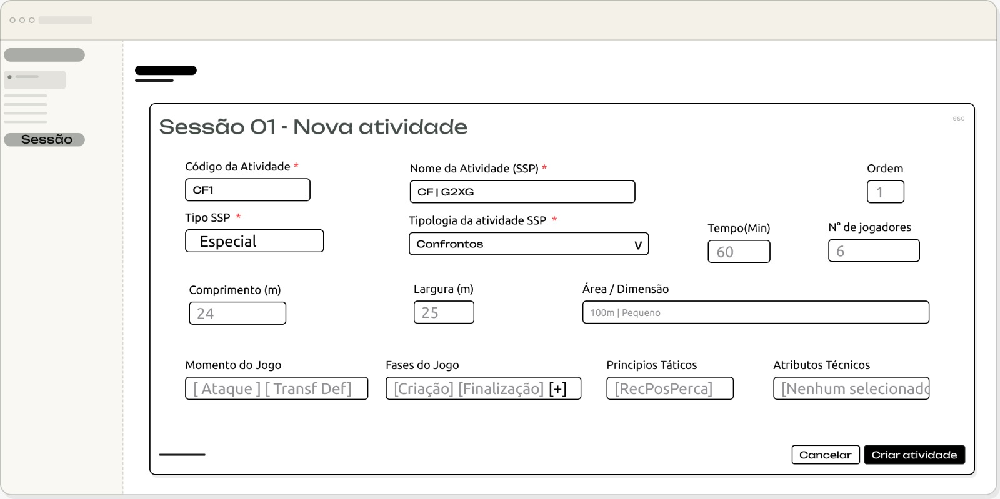

# Evidências — Iteração 8
**Período:** 26/10/2026 a 02/11/2026  
**Histórias trabalhadas:** [US10](../Requisitos-de-Software.md#rf10), [US11](../Requisitos-de-Software.md#rf11), [US16](../Requisitos-de-Software.md#rf16), [US17](../Requisitos-de-Software.md#rf17), [US19](../Requisitos-de-Software.md#rf19), [US20](../Requisitos-de-Software.md#rf20), [US23](../Requisitos-de-Software.md#rf23), [US13](../Requisitos-de-Software.md#rf13)

---

## Engenharia de Requisitos { #eng-requisitos }

### Gravações e Atas

| Evidência | Descrição |
| :--- | :--- |
| [Validação Cliente — US10](https://youtu.be/ia-ayXJykKA) | Vídeo de validação da **US10** (Cadastrar princípio tático) com o cliente Marcus Vinicius. |
| [Validação Cliente — US11](https://youtu.be/9pT__tOB93Y) | Vídeo de validação da **US11** (Editar princípio tático) com o cliente Marcus Vinicius. |
| [Print WhatsApp 03/11](../../assets/evidencias/whatsapp/whatsapp-0311-validacao-iteracao-8.png) | Validação da **US16** (Cadastrar sessão), com a alteração do tempo da sessão (D06). |
| [Print WhatsApp 03/11](../../assets/evidencias/whatsapp/whatsapp-0311-validacao-iteracao-8.png) | Validação da **US17** (Editar sessão), com a alteração do tempo da sessão (D06). |
| [Print WhatsApp 03/11](../../assets/evidencias/whatsapp/whatsapp-0311-validacao-iteracao-8.png) | Validação da **US19** (Cadastrar atividade na biblioteca), com a alteração do tempo da atividade (D07). |
| [Print WhatsApp 03/11](../../assets/evidencias/whatsapp/whatsapp-0311-validacao-iteracao-8.png) | Validação da **US20** (Editar atividade na biblioteca), com a alteração do tempo da atividade (D07). |
| [Print WhatsApp 06/11](../../assets/evidencias/whatsapp/whatsapp-0611-validacao.png) | Validação da **US23** (Reutilizar atividade cadastrada). |
| [Print WhatsApp 06/11](../../assets/evidencias/whatsapp/whatsapp-0611-validacao.png) | Validação da **US13** (Cadastrar atividade na sessão), já com o campo Ordem (D08). |
| [Ata 26/10 (Reunião Equipe 15)](../../atas-reunioes/reunioes-da-equipe.md#reuniao-da-equipe-15) | Planejamento e distribuição das histórias de sessão de treino e biblioteca de atividades (US10, US11, US13, US16, US17, US19, US20, US23). |
| [Ata 02/11 (Reunião Equipe 16)](../../atas-reunioes/reunioes-da-equipe.md#reuniao-da-equipe-16) | Revisão das entregas da iteração, validação das regras de negócio de atividades e confirmação da conclusão do fluxo de sessão. |
| [Print WhatsApp 03/10](../../assets/evidencias/whatsapp/whatsapp-0310-principio-tatico.png) | O cliente define que princípios táticos e atributos técnicos são digitados e depois ficam disponíveis para seleção, e pede para trocar "comportamento" por "princípio tático" (**US10, US11, US19**). |
| [Print WhatsApp 31/10](../../assets/evidencias/whatsapp/whatsapp-3110-prototipos-iteracao-8.png) | Vídeos dos protótipos das **US10, US11, US16, US17, US19 e US20** enviados para validação. |
| [Print WhatsApp 03/11](../../assets/evidencias/whatsapp/whatsapp-0311-ordem-atividade.png) | O cliente pede o campo Ordem no lugar do Objetivo no cadastro da atividade na sessão (**US13, US16**). |
| [Print WhatsApp 03/11](../../assets/evidencias/whatsapp/whatsapp-0311-alteracoes-enviadas.png) | Protótipos com as alterações pedidas enviados ao cliente. |
| [Print WhatsApp 05/11](../../assets/evidencias/whatsapp/whatsapp-0511-prototipos-us13-us23.png) | Vídeos dos protótipos das **US13 e US23** enviados para validação. |

### Protótipos

=== "Baixa Fidelidade"

    === "US10"
        
        *Figura 1: Vinculando comportamentos táticos.*

        
        *Figura 2: Formulário de cadastro de comportamento tático.*

        
        *Figura 3: Listagem de comportamentos táticos atualizada.*

    === "US11"
        
        *Figura 1: Formulário de edição de comportamento tático.*

        
        *Figura 2: Listagem de comportamentos táticos atualizada após edição.*

    === "US16"
        
        *Figura 1: Formulário de cadastro de sessão de treino.*

        
        *Figura 2: Listagem de sessões atualizada.*

    === "US17"
        
        *Figura 1: Formulário de edição dos dados da sessão.*

        
        *Figura 2: Listagem de sessões atualizada após edição.*

    === "US19"
        
        *Figura 1: Ação de criar atividade na biblioteca.*

        
        *Figura 2: Formulário de cadastro de atividade na biblioteca.*

        
        *Figura 3: Listagem de atividades da biblioteca atualizada.*

    === "US20"
        
        *Figura 1: Seleção para edição da atividade.*

        
        *Figura 2: Formulário de edição dos dados da atividade.*

    === "US23"
        
        *Figura 1: Adicionar atividade da biblioteca na sessão de treino.*

    === "US13"
        
        *Figura 1: Cadastro de atividade diretamente na sessão de treino.*

### Confronto Cruzado { #confronto-cruzado }

| História | Item declarado | Evidência no protótipo | Status |
| :--- | :--- | :--- | :---: |
| **US10** | Princípio tático salvo e disponível para seleção nas atividades (CA) | [Vínculo com a atividade](../../assets/evidencias/US10_comportamento_tatico.jpeg) | [x] |
| **US10** | Bloqueio de nome duplicado (CA) | Ausente: nenhum frame mostra o alerta | [] |
| **US10** | Termo "princípio tático" (RF, US, D04) | Divergente: o [formulário](../../assets/evidencias/US10_cadastrar_comportamento.jpeg) tem o botão "Criar Comportamentos" | [] |
| **US10** | Cadastro de um princípio tático por vez (RF) | Divergente: o [formulário](../../assets/evidencias/US10_cadastrar_comportamento.jpeg) cadastra vários de uma vez (botão "+"), o que não está declarado | [] |
| **US11** | Nome atualizado na lista após a edição (CA) | [Lista atualizada](../../assets/evidencias/US11_lista_atualizada_comportamento_2.jpeg) | [x] |
| **US11** | Atividades já salvas exibem o nome atualizado (CA) | Ausente: nenhum frame mostra uma atividade com o nome atualizado | [] |
| **US16** | Sessão vinculada a um microciclo válido (CA, RN04) | [Formulário](../../assets/evidencias/US16_cadastrar_sessao.jpeg) | [x] |
| **US16** | Data e número sequencial da sessão (RF) | Divergente: o [formulário](../../assets/evidencias/US16_cadastrar_sessao.jpeg) pede Nome, Data e Mês, e o número sequencial não aparece | [] |
| **US16** | Campo Microciclo obrigatório (CA) | Divergente: a [segunda versão do formulário](../../assets/evidencias/US16_nova_sessao_com_atividade.png) não tem o campo Microciclo | [] |
| **US16** | Tempo total calculado pela soma das atividades (CA, D06) | Ausente: nenhum frame mostra o tempo total da sessão | [] |
| **US16** | Atividades com a mesma ordem contam o tempo uma única vez (CA, RN03) | Ausente: nenhum frame mostra atividades simultâneas | [] |
| **US17** | Edição de nome, data e mês (CA) | [Formulário de edição](../../assets/evidencias/US17_editar_sessao.jpeg) | [x] |
| **US17** | Recálculo do tempo total ao alterar atividades (CA) | Ausente: nenhum frame mostra o tempo total recalculado | [] |
| **US19** | Área e dimensão calculadas automaticamente (CA, RN01, RN02) | [Formulário](../../assets/evidencias/US19_cadastrar_atividade_biblioteca.jpeg) | [x] |
| **US19** | Campos táticos e técnicos opcionais (CA, RN05) | [Formulário](../../assets/evidencias/US19_cadastrar_atividade_biblioteca.jpeg) | [x] |
| **US19** | Atividade da biblioteca sem campo de tempo (D07) | [Formulário](../../assets/evidencias/US19_cadastrar_atividade_biblioteca.jpeg) | [x] |
| **US19** | Estado vazio antes do primeiro cadastro (DoR) | [Estado vazio](../../assets/evidencias/US19_criar_atividade_biblioteca.jpeg) | [x] |
| **US20** | Recálculo da área e da dimensão ao editar (CA, RN01, RN02) | [Formulário de edição](../../assets/evidencias/US20_editar_atividade_biblioteca_2.jpeg) | [x] |
| **US20** | Edição não altera sessões passadas (CA) | Ausente: nenhum frame mostra uma sessão anterior preservada | [] |
| **US20** | Atividade da biblioteca sem Objetivo e sem Tempo (D07, D08) | Divergente: o frame antigo "Baixa fidelidade · US 19 - Editar Atividade da Biblioteca" ainda tem os campos Objetivo e Tempo | [] |
| **US13** | Área e dimensão calculadas automaticamente (CA, RN01, RN02) | [Formulário](../../assets/evidencias/US13_criar_atividade_na_sessao.jpeg) | [x] |
| **US13** | Campos Ordem e Tempo na atividade da sessão (D07, D08) | [Formulário](../../assets/evidencias/US13_criar_atividade_na_sessao.jpeg) | [x] |
| **US13** | Campos táticos e técnicos opcionais (CA, RN05) | [Formulário](../../assets/evidencias/US13_criar_atividade_na_sessao.jpeg) | [x] |
| **US13** | Atividades com a mesma ordem agrupadas como simultâneas (CA, RN03) | Ausente: nenhum frame mostra o agrupamento | [] |
| **US23** | Seleção de atividade da biblioteca para a sessão (RF) | [Seleção na biblioteca](../../assets/evidencias/US23_adiciona_atividade_da_biblioteca_na_sessao.jpeg) | [x] |
| **US23** | Campos da atividade preenchidos automaticamente (CA) | [Sessão com atividade adicionada](../../assets/evidencias/US16_nova_sessao_com_atividade.png) | [x] |
| **US23** | Edição após a importação sem alterar a biblioteca (CA) | Ausente: nenhum frame mostra a edição da atividade importada | [] |

**Resultado:** 14 itens conferidos e 13 com pendência. O confronto cruzado foi adotado em 16/11/2026, depois da construção desta iteração.

### Registro de Decisões e Matriz de Impacto { #registro-de-decisoes }

| ID | Decisão | Evidência | Impacto nos artefatos | Status |
| :---: | :--- | :--- | :--- | :---: |
| D04 | **03/10** — Renomear "comportamento tático" para "princípio tático". | [Print WhatsApp 03/10](../../assets/evidencias/whatsapp/whatsapp-0310-principio-tatico.png) | Atualizados: RF10, RF11, US e RN05. Pendentes: critério do RF10, protótipo, código e Catálogo de Termos. | [] |
| D05 | **03/10** — Princípios táticos e atributos técnicos são digitados uma vez e passam a ficar disponíveis para seleção. | [Print WhatsApp 03/10](../../assets/evidencias/whatsapp/whatsapp-0310-principio-tatico.png) | Atualizados: critério do RF10, código e documentação. A verificar: protótipo. | [] |
| D06 | **03/11** — O tempo da sessão é a soma dos tempos das atividades, sem campo próprio no cadastro da sessão. | [Print WhatsApp 03/11](../../assets/evidencias/whatsapp/whatsapp-0311-validacao-iteracao-8.png) | Atualizados: critérios do RF16 e RF17, RN03, protótipo e documentação. A verificar: código. | [] |
| D07 | **03/11** — O tempo da atividade é informado ao adicioná-la à sessão, e não na biblioteca. | [Print WhatsApp 03/11](../../assets/evidencias/whatsapp/whatsapp-0311-validacao-iteracao-8.png) | Atualizado: protótipo. Pendentes: critérios do RF19 e RF23 e documentação. A verificar: código. | [] |
| D08 | **03/11** — O campo Objetivo da atividade na sessão é substituído pelo campo Ordem. | [Print WhatsApp 03/11](../../assets/evidencias/whatsapp/whatsapp-0311-ordem-atividade.png) | Atualizados: critério do RF13, RN03, protótipo e documentação. A verificar: RN05 e código. | [] |

---

## Definition of Done { #dod }

### Checklist da Iteração 8

| Critério do DoD | Evidência | Status |
| :--- | :--- | :---: |
| Os critérios de aceitação foram atendidos? | [Issue US10](#) [Issue US11](#) [Issue US16](#) [Issue US17](#) [Issue US19](#) [Issue US20](#) [Issue US23](#) [Issue US13](#) | [] |
| O código foi integrado na branch staging e revisado? | [PR #26](https://github.com/mdsreq-fga-unb/REQ-2026.2-T01-FutBoard/pull/26) (US16, US17) · [PR #45](https://github.com/mdsreq-fga-unb/REQ-2026.2-T01-FutBoard/pull/45), revertido no [PR #46](https://github.com/mdsreq-fga-unb/REQ-2026.2-T01-FutBoard/pull/46) e reintegrado no [PR #48](https://github.com/mdsreq-fga-unb/REQ-2026.2-T01-FutBoard/pull/48), e [PR #51](https://github.com/mdsreq-fga-unb/REQ-2026.2-T01-FutBoard/pull/51) (US10, US11) · [PR #52](https://github.com/mdsreq-fga-unb/REQ-2026.2-T01-FutBoard/pull/52) (US19) · [PR #53](https://github.com/mdsreq-fga-unb/REQ-2026.2-T01-FutBoard/pull/53) (US13), integrados na `staging`. A US20 e a US23 ainda não têm PR. | [] |
| Os workflows de CI/CD do projeto foram executados com sucesso? | O repositório tem apenas o workflow de deploy da documentação ([deploy.yml](https://github.com/mdsreq-fga-unb/REQ-2026.2-T01-FutBoard/blob/main/.github/workflows/deploy.yml)); não há workflow de CI para o código. | [] |
| Os testes relacionados foram executados com sucesso? | Testes unitários do backend em [`apps/treinos/tests.py`](https://github.com/mdsreq-fga-unb/REQ-2026.2-T01-FutBoard/blob/staging/backend/apps/treinos/tests.py) (20 testes), sem registro de execução publicado. O frontend não tem testes. | [] |
| Os Requisitos Não Funcionais (RNFs) vinculados foram verificados? | Pendente: verificação ainda não registrada. | [] |
| A verificação integrada dos fluxos foi realizada com sucesso? | Pendente: verificação ainda não registrada. | [] |
| A documentação e evidências da entrega estão atualizadas? | Esta página de evidências, atualizada em 16/11/2026. | [] |
| A funcionalidade da User Story desenvolvida foi validada pelo cliente? | [x] [Validação US10](https://youtu.be/ia-ayXJykKA) [x] [Validação US11](https://youtu.be/9pT__tOB93Y) [] [Protótipo validado — US16](../../assets/evidencias/whatsapp/whatsapp-0311-validacao-iteracao-8.png) [] [Protótipo validado — US17](../../assets/evidencias/whatsapp/whatsapp-0311-validacao-iteracao-8.png) [] [Protótipo validado — US19](../../assets/evidencias/whatsapp/whatsapp-0311-validacao-iteracao-8.png) [] [Protótipo validado — US20](../../assets/evidencias/whatsapp/whatsapp-0311-validacao-iteracao-8.png) [] [Protótipo validado — US23](../../assets/evidencias/whatsapp/whatsapp-0611-validacao.png) [] [Protótipo validado — US13](../../assets/evidencias/whatsapp/whatsapp-0611-validacao.png) | [] |

