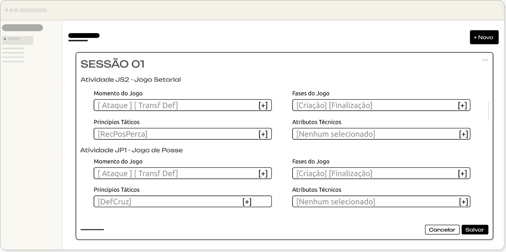
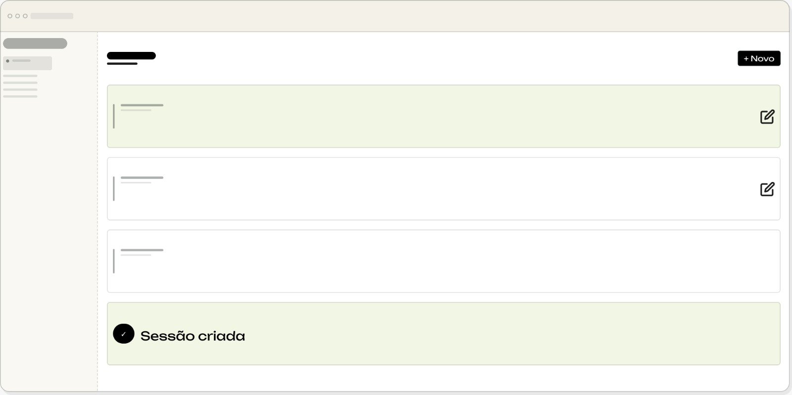
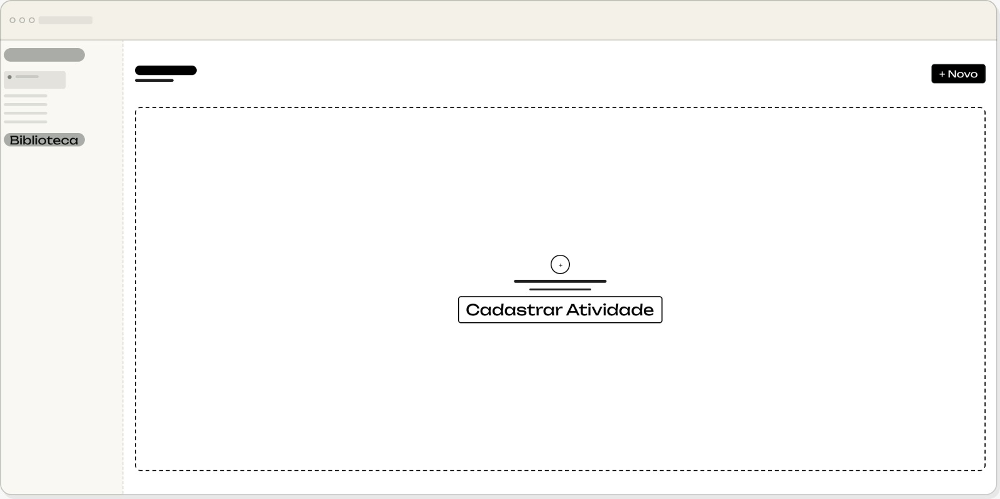
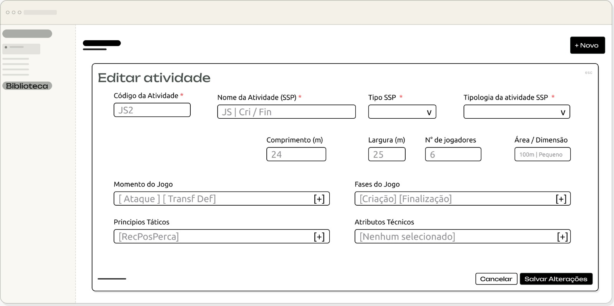

# Evidências — Iteração 8
**Período:** 26/10/2026 a 02/11/2026  
**Histórias trabalhadas:** [US10](../Requisitos-de-Software.md#rf10), [US11](../Requisitos-de-Software.md#rf11), [US16](../Requisitos-de-Software.md#rf16), [US17](../Requisitos-de-Software.md#rf17), [US19](../Requisitos-de-Software.md#rf19), [US20](../Requisitos-de-Software.md#rf20), [US23](../Requisitos-de-Software.md#rf23), [US13](../Requisitos-de-Software.md#rf13)

---

## Engenharia de Requisitos { #eng-requisitos }

### Gravações e Atas

| Evidência | Descrição |
| :--- | :--- |
| [Validação Cliente — US10](https://youtu.be/ia-ayXJykKA) | Vídeo de validação da **US10** (Cadastrar princípio tático) com o cliente Marcus Vinicius. |
| [Validação Cliente — US11](https://youtu.be/9pT__tOB93Y) | Vídeo de validação da **US11** (Editar princípio tático) com o cliente Marcus Vinicius. |
| *(Inserir link de validação — US16)* | Vídeo de validação da **US16** (Cadastrar sessão) com o cliente Marcus Vinicius. |
| *(Inserir link de validação — US17)* | Vídeo de validação da **US17** (Editar sessão) com o cliente Marcus Vinicius. |
| *(Inserir link de validação — US19)* | Vídeo de validação da **US19** (Cadastrar atividade na biblioteca) com o cliente Marcus Vinicius. |
| *(Inserir link de validação — US20)* | Vídeo de validação da **US20** (Editar atividade na biblioteca) com o cliente Marcus Vinicius. |
| *(Inserir link de validação — US23)* | Vídeo de validação da **US23** (Reutilizar atividade cadastrada) com o cliente Marcus Vinicius. |
| *(Inserir link de validação — US13)* | Vídeo de validação da **US13** (Cadastrar atividade na sessão) com o cliente Marcus Vinicius. |
| [Ata 26/10 (Reunião Equipe 15)](../../atas-reunioes/reunioes-da-equipe.md#reuniao-da-equipe-15) | Planejamento e distribuição das histórias de sessão de treino e biblioteca de atividades (US10, US11, US13, US16, US17, US19, US20, US23). |
| [Ata 02/11 (Reunião Equipe 16)](../../atas-reunioes/reunioes-da-equipe.md#reuniao-da-equipe-16) | Revisão das entregas da iteração, validação das regras de negócio de atividades e confirmação da conclusão do fluxo de sessão. |

### Protótipos

=== "Baixa Fidelidade"

    === "US10"
        
        *Figura 1: Vinculando comportamentos táticos.*

        
        *Figura 2: Formulário de cadastro de comportamento tático.*

        
        *Figura 3: Listagem de comportamentos táticos atualizada.*

    === "US11"
        
        *Figura 1: Formulário de edição de comportamento tático.*

        
        *Figura 2: Listagem de comportamentos táticos atualizada após edição.*

    === "US16"
        
        *Figura 1: Formulário de cadastro de sessão de treino.*

        
        *Figura 2: Listagem de sessões atualizada.*

    === "US17"
        
        *Figura 1: Formulário de edição dos dados da sessão.*

        
        *Figura 2: Listagem de sessões atualizada após edição.*

    === "US19"
        
        *Figura 1: Ação de criar atividade na biblioteca.*

        
        *Figura 2: Formulário de cadastro de atividade na biblioteca.*

        
        *Figura 3: Listagem de atividades da biblioteca atualizada.*

    === "US20"
        
        *Figura 1: Seleção para edição da atividade.*

        
        *Figura 2: Formulário de edição dos dados da atividade.*

    === "US23"
        
        *Figura 1: Adicionar atividade da biblioteca na sessão de treino.*

    === "US13"
        
        *Figura 1: Cadastro de atividade diretamente na sessão de treino.*

---

## Definition of Done { #dod }

### Checklist da Iteração 8

| Critério do DoD | Evidência | Status |
| :--- | :--- | :---: |
| Os critérios de aceitação foram atendidos? | [Issue US10](#) [Issue US11](#) [Issue US16](#) [Issue US17](#) [Issue US19](#) [Issue US20](#) [Issue US23](#) [Issue US13](#) | [] |
| O código foi integrado na branch main e revisado? | *(Inserir link do Pull Request)* | [] |
| Os workflows de CI/CD do projeto foram executados com sucesso? | *(Inserir link do Workflow / GitHub Actions)* | [] |
| Os testes relacionados foram executados com sucesso? | *(Inserir link da execução dos testes unitários)* | [] |
| Os Requisitos Não Funcionais (RNFs) vinculados foram verificados? | *(Inserir evidência de RNF02 — Responsividade e RNF03 — Cadastro de treino em menos de 2 min para US13, US16 e US23)* | [] |
| A verificação integrada dos fluxos foi realizada com sucesso? | *(Inserir captura de tela comprovando o vínculo entre Periodização e Sessão/Atividades)* | [] |
| A documentação e evidências da entrega estão atualizadas? | *(Inserir link do PR de atualização da documentação)* | [] |
| A funcionalidade da User Story desenvolvida foi validada pelo cliente? | [x] [Validação US10](https://youtu.be/ia-ayXJykKA) [x] [Validação US11](https://youtu.be/9pT__tOB93Y) [] [Validação US16](#) [] [Validação US17](#) [] [Validação US19](#) [] [Validação US20](#) [] [Validação US23](#) [] [Validação US13](#) | [] |

