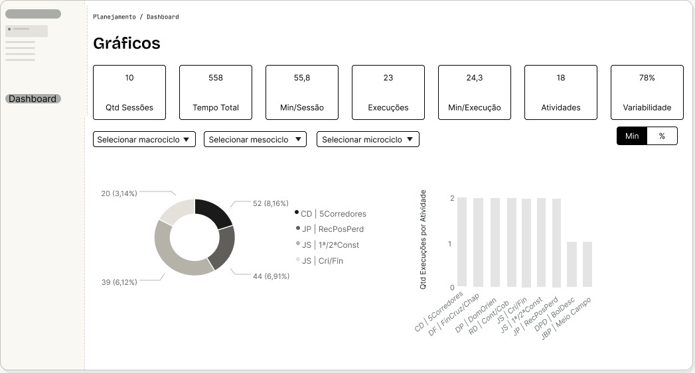
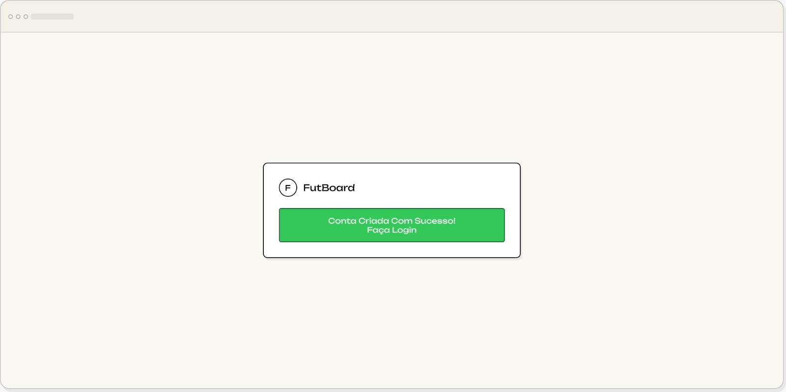
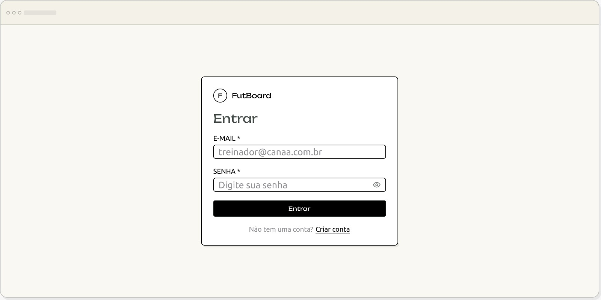

# Evidências — Iteração 9
**Período:** 02/11/2026 a 09/11/2026  
**Histórias trabalhadas:** [US14](../Requisitos-de-Software.md#rf14), [US22](../Requisitos-de-Software.md#rf22), [US24](../Requisitos-de-Software.md#rf24), [US27](../Requisitos-de-Software.md#rf27), [US28](../Requisitos-de-Software.md#rf28)

---

## Engenharia de Requisitos { #eng-requisitos }

### Gravações e Atas

| Evidência | Descrição |
| :--- | :--- |
| [Print WhatsApp 06/11](../../assets/evidencias/whatsapp/whatsapp-0611-validacao.png) | Validação da **US14** pelo cliente. |
| [Print WhatsApp 06/11](../../assets/evidencias/whatsapp/whatsapp-0611-validacao.png) | Validação da **US22** pelo cliente. |
| [Print WhatsApp 12/11](../../assets/evidencias/whatsapp/whatsapp-1211-prototipo-us24.png) | Protótipo da **US24** enviado em 12/11; aguardando resposta do cliente. |
| [Print WhatsApp 06/11](../../assets/evidencias/whatsapp/whatsapp-0611-validacao.png) | Validação da **US27** pelo cliente. |
| [Print WhatsApp 06/11](../../assets/evidencias/whatsapp/whatsapp-0611-validacao.png) | Validação da **US28** pelo cliente. |
| [Ata 02/11 (Reunião Equipe 16)](../../atas-reunioes/reunioes-da-equipe.md#reuniao-da-equipe-16) | Abertura da Iteração 9, inclusão das histórias de controle de acesso (US27 e US28) e divisão das tarefas entre a equipe (US14, US22, US24, US27 e US28). |
| [Print WhatsApp 05/11](../../assets/evidencias/whatsapp/whatsapp-0511-prototipos-us14-us22-us27-us28.png) | Vídeos dos protótipos das **US14, US22, US27 e US28** enviados para validação, a pedido do cliente. |

### Protótipos

=== "Baixa Fidelidade"

    === "US14"
        
        *Figura 1: Formulário de edição de atividade na sessão.*

        
        *Figura 2: Listagem de atividades da sessão atualizada após edição.*

    === "US22"
        
        *Figura 1: Visualização dos indicadores do treino.*

    === "US24"
        
        *Figura 1: Consulta de informações detalhadas da atividade do treino.*

    === "US27"
        
        *Figura 1: Formulário de cadastro de nova conta.*

        
        *Figura 2: Confirmação de criação de conta com sucesso.*

    === "US28"
        
        *Figura 1: Tela de login e autenticação de usuário.*

### Confronto Cruzado { #confronto-cruzado }

| História | Item declarado | Evidência no protótipo | Status |
| :--- | :--- | :--- | :---: |
| **US14** | Recálculo da área e da dimensão ao editar (CA, RN01, RN02) | [Formulário de edição](../../assets/evidencias/US14_editar_atividade_sessao_formulario.jpeg) | [x] |
| **US14** | Reagrupamento das atividades ao alterar a ordem, afetando o tempo total (CA, RN03) | Ausente: nenhum frame mostra o reagrupamento | [] |
| **US14** | Título do formulário de edição | Divergente: o [formulário de edição](../../assets/evidencias/US14_editar_atividade_sessao_formulario.jpeg) tem o título "Sessão 01 - Nova atividade" | [] |
| **US22** | Minutos totais sem contar o tempo sobreposto (CA, RN03) | [Card Tempo Total](../../assets/evidencias/US22_indicadores_treino.jpeg) | [x] |
| **US22** | Variabilidade (CA, RN06) | [Card Variabilidade](../../assets/evidencias/US22_indicadores_treino.jpeg) | [x] |
| **US22** | Valores neutros quando não há dados no período (CA, RN07) | Ausente: nenhum frame mostra o estado vazio | [] |
| **US24** | Gráfico das atividades executadas (CA) | [Gráficos](../../assets/evidencias/US24_consultar_informacao_atividade_treino.jpeg) | [x] |
| **US24** | Estado vazio quando o filtro não encontra dados (CA, RN07) | Ausente: nenhum frame mostra o estado vazio | [] |
| **US27** | Cadastro com e-mail e senha (CA) | [Formulário](../../assets/evidencias/US27_criar_conta.jpeg) | [x] |
| **US27** | Alerta de e-mail já cadastrado (CA) | Ausente: os alertas desenhados ([campos obrigatórios](../../assets/evidencias/US27_campos_obrigatorios.png) e [senhas diferentes](../../assets/evidencias/US27_senhas_diferentes.png)) não incluem e-mail já cadastrado | [] |
| **US28** | Mensagem de erro com credenciais inválidas (CA) | [Credenciais incorretas](../../assets/evidencias/US28_credenciais_incorretas.png) | [x] |
| **US28** | Redirecionamento para o dashboard após o login (CA) | Divergente: o [acesso após o login](../../assets/evidencias/US28_acesso.png) leva à tela de macrociclos | [] |

**Resultado:** 6 itens conferidos e 6 com pendência. O confronto foi feito antes da construção, que ainda não começou.

### Registro de Decisões e Matriz de Impacto { #registro-de-decisoes }

| ID | Decisão | Evidência | Impacto nos artefatos | Status |
| :---: | :--- | :--- | :--- | :---: |
| D09 | **16/11** — RF27 e RF28 reclassificados de Q4 para Q1 e incluídos no MVP. | [Backlog do Produto](../backlog_do_produto.md) | Atualizados: backlog, RF27, RF28, US e protótipo. A verificar: critérios e código. | [] |

---

## Definition of Done { #dod }

### Checklist da Iteração 9

| Critério do DoD | Evidência | Status |
| :--- | :--- | :---: |
| Os critérios de aceitação foram atendidos? | [Issue US14](#) [Issue US22](#) [Issue US24](#) [Issue US27](#) [Issue US28](#) | [] |
| O código foi integrado na branch staging e revisado? | Nenhum PR das histórias desta iteração até 16/11/2026. | [] |
| Os workflows de CI/CD do projeto foram executados com sucesso? | O repositório tem apenas o workflow de deploy da documentação ([deploy.yml](https://github.com/mdsreq-fga-unb/REQ-2026.2-T01-FutBoard/blob/main/.github/workflows/deploy.yml)); não há workflow de CI para o código. | [] |
| Os testes relacionados foram executados com sucesso? | Testes de autenticação em [`apps/usuarios/tests.py`](https://github.com/mdsreq-fga-unb/REQ-2026.2-T01-FutBoard/blob/staging/backend/apps/usuarios/tests.py) (2 testes), sem registro de execução publicado. | [] |
| Os Requisitos Não Funcionais (RNFs) vinculados foram verificados? | Pendente: verificação ainda não registrada. | [] |
| A verificação integrada dos fluxos foi realizada com sucesso? | Pendente: verificação ainda não registrada. | [] |
| A documentação e evidências da entrega estão atualizadas? | Esta página de evidências, atualizada em 16/11/2026. | [] |
| A funcionalidade da User Story desenvolvida foi validada pelo cliente? | [] [Protótipo validado — US14](../../assets/evidencias/whatsapp/whatsapp-0611-validacao.png) [] [Protótipo validado — US22](../../assets/evidencias/whatsapp/whatsapp-0611-validacao.png) [] [Protótipo enviado — US24](../../assets/evidencias/whatsapp/whatsapp-1211-prototipo-us24.png) [] [Protótipo validado — US27](../../assets/evidencias/whatsapp/whatsapp-0611-validacao.png) [] [Protótipo validado — US28](../../assets/evidencias/whatsapp/whatsapp-0611-validacao.png) | [] |

