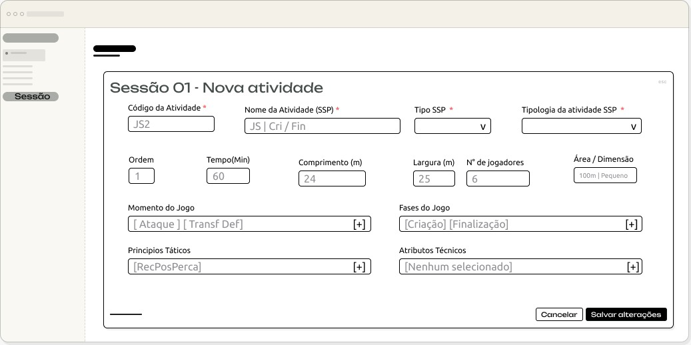

# Evidências — Iteração 9
**Período:** 02/11/2026 a 09/11/2026  
**Histórias trabalhadas:** [US14](../Requisitos-de-Software.md#rf14), [US22](../Requisitos-de-Software.md#rf22), [US24](../Requisitos-de-Software.md#rf24), [US27](../Requisitos-de-Software.md#rf27), [US28](../Requisitos-de-Software.md#rf28)

---

## Engenharia de Requisitos { #eng-requisitos }

### Gravações e Atas

| Evidência | Descrição |
| :--- | :--- |
| *(Inserir link de validação — US14)* | Vídeo de validação da **US14** com o cliente Marcus Vinicius. |
| *(Inserir link de validação — US22)* | Vídeo de validação da **US22** com o cliente Marcus Vinicius. |
| *(Inserir link de validação — US24)* | Vídeo de validação da **US24** com o cliente Marcus Vinicius. |
| *(Inserir link de validação — US27)* | Vídeo de validação da **US27** com o cliente Marcus Vinicius. |
| *(Inserir link de validação — US28)* | Vídeo de validação da **US28** com o cliente Marcus Vinicius. |
| [Ata 02/11 (Reunião Equipe 16)](../../atas-reunioes/reunioes-da-equipe.md#reuniao-da-equipe-16) | Abertura da Iteração 9, inclusão das histórias de controle de acesso (US27 e US28) e divisão das tarefas entre a equipe (US14, US22, US24, US27 e US28). |

### Protótipos

=== "Baixa Fidelidade"

    === "US14"
        
        *Figura 1: Formulário de edição de atividade na sessão.*

        
        *Figura 2: Listagem de atividades da sessão atualizada após edição.*

    === "US22"
        
        *Figura 1: Visualização dos indicadores do treino.*

    === "US24"
        
        *Figura 1: Consulta de informações detalhadas da atividade do treino.*

    === "US27"
        
        *Figura 1: Formulário de cadastro de nova conta.*

        
        *Figura 2: Confirmação de criação de conta com sucesso.*

    === "US28"
        
        *Figura 1: Tela de login e autenticação de usuário.*

---

## Definition of Done { #dod }

### Checklist da Iteração 9

| Critério do DoD | Evidência | Status |
| :--- | :--- | :---: |
| Os critérios de aceitação foram atendidos? | [Issue US14](#) [Issue US22](#) [Issue US24](#) [Issue US27](#) [Issue US28](#) | [] |
| O código foi integrado na branch main e revisado? | *(Inserir link do Pull Request)* | [] |
| Os workflows de CI/CD do projeto foram executados com sucesso? | *(Inserir link do Workflow / GitHub Actions)* | [] |
| Os testes relacionados foram executados com sucesso? | *(Inserir link da execução dos testes unitários)* | [] |
| Os Requisitos Não Funcionais (RNFs) vinculados foram verificados? | *(Inserir evidência de RNF01 — Proteção de Dados/Autenticação para US27 e US28, e RNF02 — Responsividade)* | [] |
| A verificação integrada dos fluxos foi realizada com sucesso? | *(Inserir captura de tela comprovando a consistência da listagem e detalhes de sessões/atividades)* | [] |
| A documentação e evidências da entrega estão atualizadas? | *(Inserir link do PR de atualização da documentação)* | [] |
| A funcionalidade da User Story desenvolvida foi validada pelo cliente? | [] [Validação US14](#) [] [Validação US22](#) [] [Validação US24](#) [] [Validação US27](#) [] [Validação US28](#) | [] |

