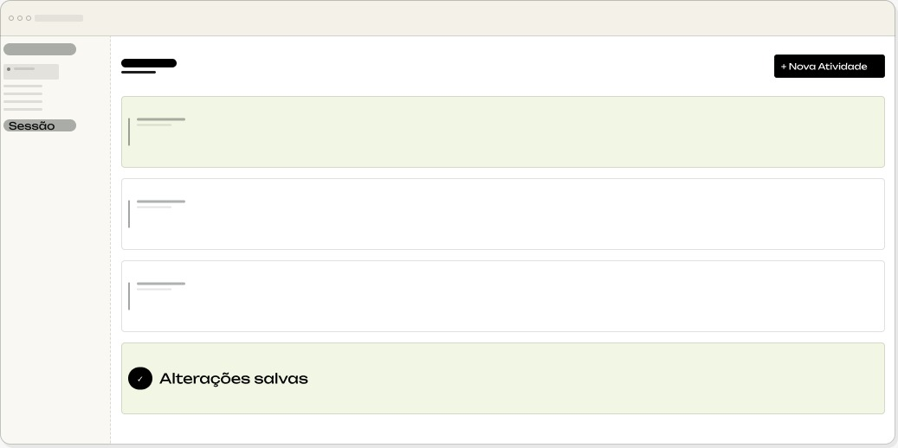
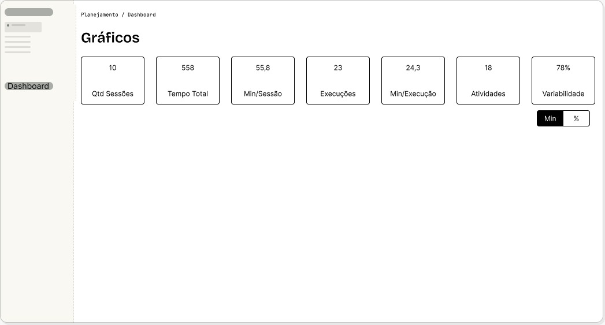
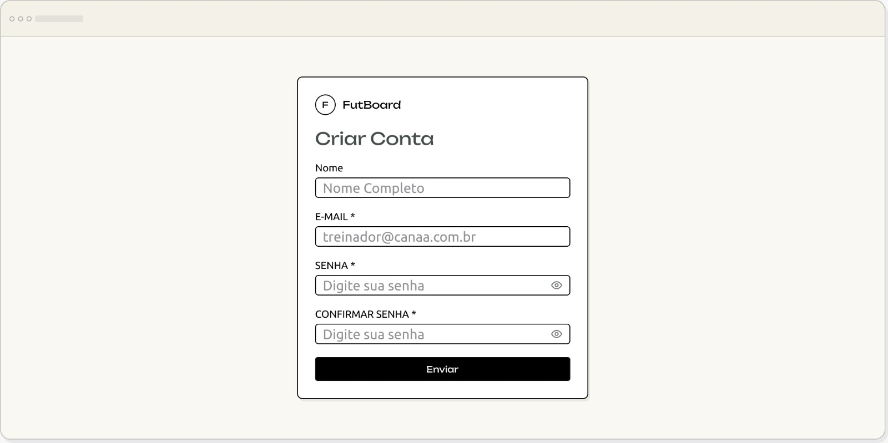

# Evidências — Iteração 9
**Período:** 02/11/2026 a 09/11/2026  
**Histórias trabalhadas:** [US14](../Requisitos-de-Software.md#rf14), [US22](../Requisitos-de-Software.md#rf22), [US24](../Requisitos-de-Software.md#rf24), [US27](../Requisitos-de-Software.md#rf27), [US28](../Requisitos-de-Software.md#rf28)

---

## Engenharia de Requisitos { #eng-requisitos }

### Gravações e Atas

| Evidência | Descrição |
| :--- | :--- |
| [Print WhatsApp 06/11](../../assets/evidencias/whatsapp/whatsapp-0611-validacao.png) | Validação da **US14** pelo cliente. |
| [Print WhatsApp 06/11](../../assets/evidencias/whatsapp/whatsapp-0611-validacao.png) | Validação da **US22** pelo cliente. |
| [Print WhatsApp 12/11](../../assets/evidencias/whatsapp/whatsapp-1211-prototipo-us24.png) | Protótipo da **US24** enviado em 12/11; aguardando resposta do cliente. |
| [Print WhatsApp 06/11](../../assets/evidencias/whatsapp/whatsapp-0611-validacao.png) | Validação da **US27** pelo cliente. |
| [Print WhatsApp 06/11](../../assets/evidencias/whatsapp/whatsapp-0611-validacao.png) | Validação da **US28** pelo cliente. |
| [Ata 02/11 (Reunião Equipe 16)](../../atas-reunioes/reunioes-da-equipe.md#reuniao-da-equipe-16) | Abertura da Iteração 9, inclusão das histórias de controle de acesso (US27 e US28) e divisão das tarefas entre a equipe (US14, US22, US24, US27 e US28). |
| [Print WhatsApp 05/11](../../assets/evidencias/whatsapp/whatsapp-0511-prototipos-us14-us22-us27-us28.png) | Vídeos dos protótipos das **US14, US22, US27 e US28** enviados para validação, a pedido do cliente. |

### Protótipos

=== "Baixa Fidelidade"

    === "US14"
        
        *Figura 1: Formulário de edição de atividade na sessão.*

        
        *Figura 2: Listagem de atividades da sessão atualizada após edição.*

    === "US22"
        
        *Figura 1: Visualização dos indicadores do treino.*

    === "US24"
        
        *Figura 1: Consulta de informações detalhadas da atividade do treino.*

    === "US27"
        
        *Figura 1: Formulário de cadastro de nova conta.*

        
        *Figura 2: Confirmação de criação de conta com sucesso.*

    === "US28"
        
        *Figura 1: Tela de login e autenticação de usuário.*

### Registro de Decisões e Matriz de Impacto { #registro-de-decisoes }

| ID | Decisão | Evidência | Impacto nos artefatos | Status |
| :---: | :--- | :--- | :--- | :---: |
| D09 | **16/11** — RF27 e RF28 reclassificados de Q4 para Q1 e incluídos no MVP. | [Backlog do Produto](../backlog_do_produto.md) | Atualizados: backlog, RF27, RF28, US e protótipo. A verificar: critérios e código. | [] |

---

## Definition of Done { #dod }

### Checklist por História — Iteração 9

=== "US14"

    | Critério do DoD | Evidência | Status |
    | :--- | :--- | :---: |
    | Os critérios de aceitação foram atendidos? | [Issue US14](#) | [] |
    | O código foi integrado na branch main e revisado? | Nenhum PR da US14 integrado até 16/11/2026. | [] |
    | Os workflows de CI/CD do projeto foram executados com sucesso? | O repositório tem apenas o workflow de deploy da documentação ([deploy.yml](https://github.com/mdsreq-fga-unb/REQ-2026.2-T01-FutBoard/blob/main/.github/workflows/deploy.yml)); não há workflow de CI para o código na `main`. | [] |
    | Os testes relacionados foram executados com sucesso? | Nenhum teste registrado para a US14 até 16/11/2026. | [] |
    | Os Requisitos Não Funcionais (RNFs) vinculados foram verificados? | Pendente: verificação ainda não registrada (RNF02, RNF04). | [] |
    | A verificação integrada dos fluxos foi realizada com sucesso? | Pendente: verificação ainda não registrada. | [] |
    | A documentação e evidências da entrega estão atualizadas? | Esta página de evidências, atualizada em 16/11/2026. | [] |
    | A funcionalidade da User Story desenvolvida foi validada pelo cliente? | Pendente validação da funcionalidade implementada. [Protótipo validado — US14](../../assets/evidencias/whatsapp/whatsapp-0611-validacao.png) | [] |

=== "US22"

    | Critério do DoD | Evidência | Status |
    | :--- | :--- | :---: |
    | Os critérios de aceitação foram atendidos? | [Issue US22](#) | [] |
    | O código foi integrado na branch main e revisado? | Nenhum PR da US22 integrado até 16/11/2026. | [] |
    | Os workflows de CI/CD do projeto foram executados com sucesso? | O repositório tem apenas o workflow de deploy da documentação ([deploy.yml](https://github.com/mdsreq-fga-unb/REQ-2026.2-T01-FutBoard/blob/main/.github/workflows/deploy.yml)); não há workflow de CI para o código na `main`. | [] |
    | Os testes relacionados foram executados com sucesso? | Nenhum teste registrado para a US22 até 16/11/2026. | [] |
    | Os Requisitos Não Funcionais (RNFs) vinculados foram verificados? | Pendente: verificação ainda não registrada (RNF02, RNF04). | [] |
    | A verificação integrada dos fluxos foi realizada com sucesso? | Pendente: verificação ainda não registrada. | [] |
    | A documentação e evidências da entrega estão atualizadas? | Esta página de evidências, atualizada em 16/11/2026. | [] |
    | A funcionalidade da User Story desenvolvida foi validada pelo cliente? | Pendente validação da funcionalidade implementada. [Protótipo validado — US22](../../assets/evidencias/whatsapp/whatsapp-0611-validacao.png) | [] |

=== "US24"

    | Critério do DoD | Evidência | Status |
    | :--- | :--- | :---: |
    | Os critérios de aceitação foram atendidos? | [Issue US24](#) | [] |
    | O código foi integrado na branch main e revisado? | Nenhum PR da US24 integrado até 16/11/2026. | [] |
    | Os workflows de CI/CD do projeto foram executados com sucesso? | O repositório tem apenas o workflow de deploy da documentação ([deploy.yml](https://github.com/mdsreq-fga-unb/REQ-2026.2-T01-FutBoard/blob/main/.github/workflows/deploy.yml)); não há workflow de CI para o código na `main`. | [] |
    | Os testes relacionados foram executados com sucesso? | Nenhum teste registrado para a US24 até 16/11/2026. | [] |
    | Os Requisitos Não Funcionais (RNFs) vinculados foram verificados? | Pendente: verificação ainda não registrada (RNF02, RNF04). | [] |
    | A verificação integrada dos fluxos foi realizada com sucesso? | Pendente: verificação ainda não registrada. | [] |
    | A documentação e evidências da entrega estão atualizadas? | Esta página de evidências, atualizada em 16/11/2026. | [] |
    | A funcionalidade da User Story desenvolvida foi validada pelo cliente? | Pendente validação da funcionalidade implementada. [Protótipo enviado — US24](../../assets/evidencias/whatsapp/whatsapp-1211-prototipo-us24.png) | [] |

=== "US27"

    | Critério do DoD | Evidência | Status |
    | :--- | :--- | :---: |
    | Os critérios de aceitação foram atendidos? | [Issue US27](#) | [] |
    | O código foi integrado na branch main e revisado? | Nenhum PR da US27 integrado até 16/11/2026. | [] |
    | Os workflows de CI/CD do projeto foram executados com sucesso? | O repositório tem apenas o workflow de deploy da documentação ([deploy.yml](https://github.com/mdsreq-fga-unb/REQ-2026.2-T01-FutBoard/blob/main/.github/workflows/deploy.yml)); não há workflow de CI para o código na `main`. | [] |
    | Os testes relacionados foram executados com sucesso? | Testes de autenticação em [`apps/usuarios/tests.py`](https://github.com/mdsreq-fga-unb/REQ-2026.2-T01-FutBoard/blob/staging/backend/apps/usuarios/tests.py) (2 testes), sem registro de execução publicado. | [] |
    | Os Requisitos Não Funcionais (RNFs) vinculados foram verificados? | Pendente: verificação ainda não registrada (RNF01, RNF02). | [] |
    | A verificação integrada dos fluxos foi realizada com sucesso? | Não se aplica ao fluxo de dashboard/PDF (história de criação de conta); pendente validar integração com o login (US28). | [] |
    | A documentação e evidências da entrega estão atualizadas? | Esta página de evidências, atualizada em 16/11/2026. | [] |
    | A funcionalidade da User Story desenvolvida foi validada pelo cliente? | Pendente validação da funcionalidade implementada. [Protótipo validado — US27](../../assets/evidencias/whatsapp/whatsapp-0611-validacao.png) | [] |

=== "US28"

    | Critério do DoD | Evidência | Status |
    | :--- | :--- | :---: |
    | Os critérios de aceitação foram atendidos? | [Issue US28](#) | [] |
    | O código foi integrado na branch main e revisado? | Nenhum PR da US28 integrado até 16/11/2026. | [] |
    | Os workflows de CI/CD do projeto foram executados com sucesso? | O repositório tem apenas o workflow de deploy da documentação ([deploy.yml](https://github.com/mdsreq-fga-unb/REQ-2026.2-T01-FutBoard/blob/main/.github/workflows/deploy.yml)); não há workflow de CI para o código na `main`. | [] |
    | Os testes relacionados foram executados com sucesso? | Testes de autenticação em [`apps/usuarios/tests.py`](https://github.com/mdsreq-fga-unb/REQ-2026.2-T01-FutBoard/blob/staging/backend/apps/usuarios/tests.py) (2 testes), sem registro de execução publicado. | [] |
    | Os Requisitos Não Funcionais (RNFs) vinculados foram verificados? | Pendente: verificação ainda não registrada (RNF01, RNF02). | [] |
    | A verificação integrada dos fluxos foi realizada com sucesso? | Não se aplica ao fluxo de dashboard/PDF (história de login); pendente validar integração do login com o acesso às telas protegidas. | [] |
    | A documentação e evidências da entrega estão atualizadas? | Esta página de evidências, atualizada em 16/11/2026. | [] |
    | A funcionalidade da User Story desenvolvida foi validada pelo cliente? | Pendente validação da funcionalidade implementada. [Protótipo validado — US28](../../assets/evidencias/whatsapp/whatsapp-0611-validacao.png) | [] |

