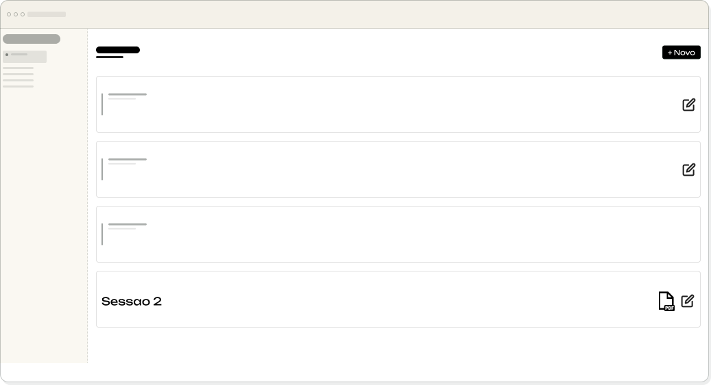
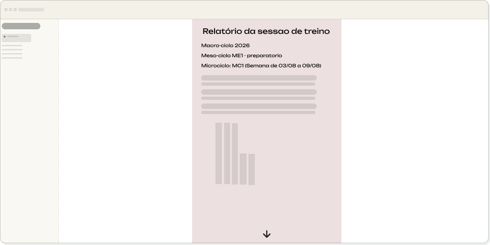
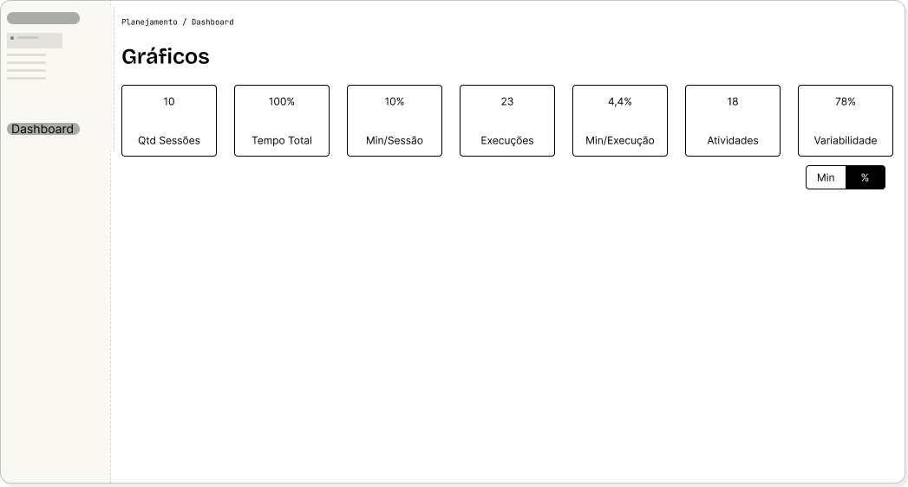
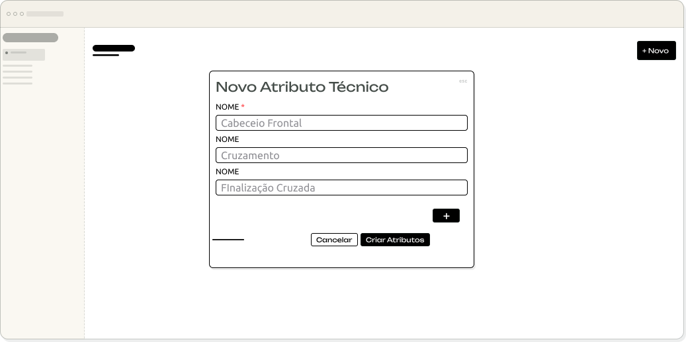
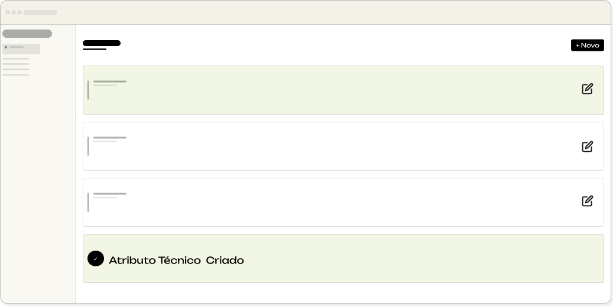
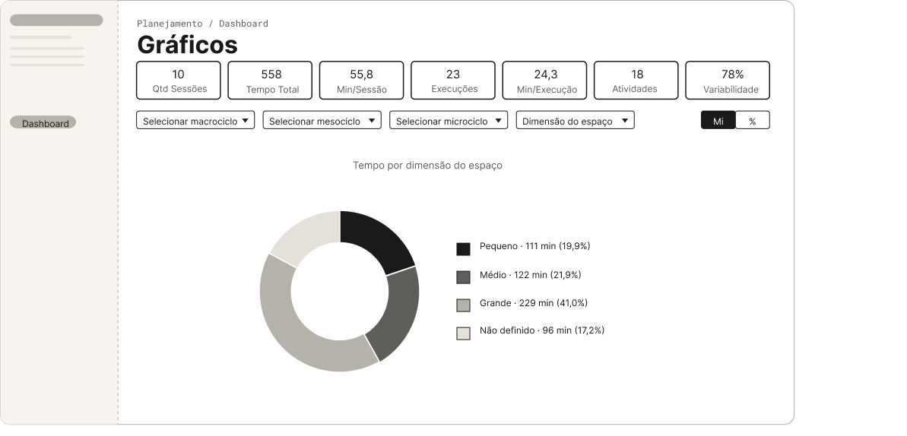

# Evidências — Iteração 10
**Período:** 09/11/2026 a 16/11/2026  
**Histórias trabalhadas:** [US25](../Requisitos-de-Software.md#rf25), [US26](../Requisitos-de-Software.md#rf26), [US32](../Requisitos-de-Software.md#rf32), [US35](../Requisitos-de-Software.md#rf35), [US39](../Requisitos-de-Software.md#rf39)

---

## Engenharia de Requisitos { #eng-requisitos }

### Gravações e Atas

| Evidência | Descrição |
| :--- | :--- |
| [Print WhatsApp 12/11](../../assets/evidencias/whatsapp/whatsapp-1211-prototipos-iteracao-10.png) | Protótipo da **US25** enviado em 12/11; aguardando resposta do cliente. |
| [Print WhatsApp 12/11](../../assets/evidencias/whatsapp/whatsapp-1211-prototipos-iteracao-10.png) | Protótipo da **US26** enviado em 12/11; aguardando resposta do cliente. |
| [Print WhatsApp 12/11](../../assets/evidencias/whatsapp/whatsapp-1211-prototipos-iteracao-10.png) | Protótipo da **US32** enviado em 12/11; aguardando resposta do cliente. |
| [Print WhatsApp 12/11](../../assets/evidencias/whatsapp/whatsapp-1211-prototipos-iteracao-10.png) | Protótipo da **US35** enviado em 12/11; aguardando resposta do cliente. |
| [Print WhatsApp 12/11](../../assets/evidencias/whatsapp/whatsapp-1211-prototipos-iteracao-10.png) | Protótipo da **US39** enviado em 12/11; aguardando resposta do cliente. |
| [Ata 02/11 (Reunião Equipe 16)](../../atas-reunioes/reunioes-da-equipe.md#reuniao-da-equipe-16) | Última reunião da equipe registrada; nenhuma reunião da equipe registrada no período desta iteração (09/11 a 16/11). |
| [Print WhatsApp 12/11](../../assets/evidencias/whatsapp/whatsapp-1211-filtro-tempo.png) | O cliente prefere um filtro para alternar tempo absoluto e relativo nos gráficos, com o relativo calculado sobre o tempo total (**US26**). |

### Protótipos

=== "Baixa Fidelidade"

    === "US25"
        
        *Figura 1: Listagem de sessões com a opção de gerar o relatório em PDF.*

        
        *Figura 2: Relatório da sessão de treino.*

    === "US26"
        
        *Figura 1: Indicadores exibidos em tempo relativo (%).*

    === "US32"
        
        *Figura 1: Formulário de cadastro de atributos técnicos.*

        
        *Figura 2: Listagem de atributos técnicos atualizada.*

    === "US35"
        
        *Figura 1: Gráfico de tempo por dimensão do espaço.*

    === "US39"
        
        *Figura 1: Gráfico de tempo por princípio tático.*

### Confronto Cruzado { #confronto-cruzado }

| História | Item declarado | Evidência no protótipo | Status |
| :--- | :--- | :--- | :---: |
| **US25** | Critérios de aceitação | O [protótipo](../../assets/evidencias/US25_lista_sessoes.png) foi enviado ao cliente em 12/11 e aguarda validação; os critérios entram na issue da história depois dela | [] |
| **US26** | Critérios de aceitação | O [protótipo](../../assets/evidencias/US26_tempo_relativo.png) foi enviado ao cliente em 12/11 e aguarda validação; os critérios entram na issue da história depois dela | [] |
| **US32** | Critérios de aceitação | O [protótipo](../../assets/evidencias/US32_novo_atributo_tecnico.png) foi enviado ao cliente em 12/11 e aguarda validação; os critérios entram na issue da história depois dela | [] |
| **US35** | Critérios de aceitação | O [protótipo](../../assets/evidencias/US35_consulta_espaco.png) foi enviado ao cliente em 12/11 e aguarda validação; os critérios entram na issue da história depois dela | [] |
| **US39** | Critérios de aceitação | O [protótipo](../../assets/evidencias/US39_consulta_principio_tatico.png) foi enviado ao cliente em 12/11 e aguarda validação; os critérios entram na issue da história depois dela | [] |

**Resultado:** os protótipos foram enviados ao cliente em 12/11 e aguardam validação. Pelo processo da equipe, os critérios de aceitação são declarados na issue de cada história depois que o cliente valida o protótipo; o confronto é feito em seguida, antes da construção.

### Registro de Decisões e Matriz de Impacto { #registro-de-decisoes }

| ID | Decisão | Evidência | Impacto nos artefatos | Status |
| :---: | :--- | :--- | :--- | :---: |
| D10 | **12/11** — Um gráfico com filtro de tempo absoluto e relativo, em vez de dois gráficos; o relativo é calculado sobre o tempo total. | [Print WhatsApp 12/11](../../assets/evidencias/whatsapp/whatsapp-1211-filtro-tempo.png) | Atualizados: RF26, US e RN03. Pendentes: critérios do RF26, RF37 e RF38 e código. A verificar: protótipo. | [] |

---

## Definition of Done { #dod }

### Checklist da Iteração 10

| Critério do DoD | Evidência | Status |
| :--- | :--- | :---: |
| Os critérios de aceitação foram atendidos? | [Issue US25](#) [Issue US26](#) [Issue US32](#) [Issue US35](#) [Issue US39](#) | [] |
| O código foi integrado na branch main e revisado? | Nenhum PR das histórias desta iteração até 16/11/2026. | [] |
| Os workflows de CI/CD do projeto foram executados com sucesso? | O repositório tem apenas o workflow de deploy da documentação ([deploy.yml](https://github.com/mdsreq-fga-unb/REQ-2026.2-T01-FutBoard/blob/main/.github/workflows/deploy.yml)); não há workflow de CI para o código. | [] |
| Os testes relacionados foram executados com sucesso? | Nenhum teste das histórias desta iteração até 16/11/2026. | [] |
| Os Requisitos Não Funcionais (RNFs) vinculados foram verificados? | Pendente: verificação ainda não registrada. | [] |
| A verificação integrada dos fluxos foi realizada com sucesso? | Pendente: verificação ainda não registrada. | [] |
| A documentação e evidências da entrega estão atualizadas? | Esta página de evidências, atualizada em 16/11/2026. | [] |
| A funcionalidade da User Story desenvolvida foi validada pelo cliente? | [] [Protótipo enviado — US25](../../assets/evidencias/whatsapp/whatsapp-1211-prototipos-iteracao-10.png) [] [Protótipo enviado — US26](../../assets/evidencias/whatsapp/whatsapp-1211-prototipos-iteracao-10.png) [] [Protótipo enviado — US32](../../assets/evidencias/whatsapp/whatsapp-1211-prototipos-iteracao-10.png) [] [Protótipo enviado — US35](../../assets/evidencias/whatsapp/whatsapp-1211-prototipos-iteracao-10.png) [] [Protótipo enviado — US39](../../assets/evidencias/whatsapp/whatsapp-1211-prototipos-iteracao-10.png) | [] |

