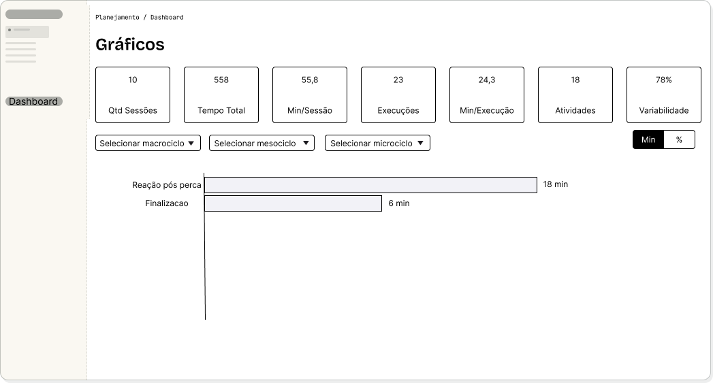

# Evidências — Iteração 10
**Período:** 09/11/2026 a 16/11/2026  
**Histórias trabalhadas:** [US25](../Requisitos-de-Software.md#rf25), [US26](../Requisitos-de-Software.md#rf26), [US32](../Requisitos-de-Software.md#rf32), [US35](../Requisitos-de-Software.md#rf35), [US38](../Requisitos-de-Software.md#rf38)

---

## Engenharia de Requisitos { #eng-requisitos }

### Gravações e Atas

| Evidência | Descrição |
| :--- | :--- |
| [Print WhatsApp 12/11](../../assets/evidencias/whatsapp/whatsapp-1211-prototipos-iteracao-10.png) | Protótipo da **US25** enviado em 12/11; aguardando resposta do cliente. |
| [Print WhatsApp 12/11](../../assets/evidencias/whatsapp/whatsapp-1211-prototipos-iteracao-10.png) | Protótipo da **US26** enviado em 12/11; aguardando resposta do cliente. |
| [Print WhatsApp 12/11](../../assets/evidencias/whatsapp/whatsapp-1211-prototipos-iteracao-10.png) | Protótipo da **US32** enviado em 12/11; aguardando resposta do cliente. |
| [Print WhatsApp 12/11](../../assets/evidencias/whatsapp/whatsapp-1211-prototipos-iteracao-10.png) | Protótipo da **US35** enviado em 12/11; aguardando resposta do cliente. |
| [Print WhatsApp 12/11](../../assets/evidencias/whatsapp/whatsapp-1211-prototipos-iteracao-10.png) | Protótipo da **US38** enviado em 12/11; aguardando resposta do cliente. |
| [Ata 02/11 (Reunião Equipe 16)](../../atas-reunioes/reunioes-da-equipe.md#reuniao-da-equipe-16) | Última reunião da equipe registrada; nenhuma reunião da equipe registrada no período desta iteração (09/11 a 16/11). |
| [Print WhatsApp 12/11](../../assets/evidencias/whatsapp/whatsapp-1211-filtro-tempo.png) | O cliente prefere um filtro para alternar tempo absoluto e relativo nos gráficos, com o relativo calculado sobre o tempo total (**US26**). |

### Protótipos

=== "Baixa Fidelidade"

    === "US25"
        
        *Figura 1: Listagem de sessões com a opção de gerar o relatório em PDF.*

        
        *Figura 2: Relatório da sessão de treino.*

    === "US26"
        
        *Figura 1: Indicadores exibidos em tempo relativo (%).*

    === "US32"
        
        *Figura 1: Formulário de cadastro de atributos técnicos.*

        
        *Figura 2: Listagem de atributos técnicos atualizada.*

    === "US35"
        
        *Figura 1: Gráfico de tempo por dimensão do espaço.*

    === "US38"
        
        *Figura 1: Gráfico de tempo por princípio tático.*

### Registro de Decisões e Matriz de Impacto { #registro-de-decisoes }

| ID | Decisão | Evidência | Impacto nos artefatos | Status |
| :---: | :--- | :--- | :--- | :---: |
| D10 | **12/11** — Um gráfico com filtro de tempo absoluto e relativo, em vez de dois gráficos; o relativo é calculado sobre o tempo total. | [Print WhatsApp 12/11](../../assets/evidencias/whatsapp/whatsapp-1211-filtro-tempo.png) | Atualizados: RF26, US e RN03. Pendentes: critérios do RF26, RF36 e RF37 e código. A verificar: protótipo. | [] |

---

## Definition of Done { #dod }

### Checklist por História — Iteração 10

=== "US25"

    | Critério do DoD | Evidência | Status |
    | :--- | :--- | :---: |
    | Os critérios de aceitação foram atendidos? | [Issue US25](#) | [] |
    | O código foi integrado na branch main e revisado? | Nenhum PR da US25 integrado até 16/11/2026. | [] |
    | Os workflows de CI/CD do projeto foram executados com sucesso? | O repositório tem apenas o workflow de deploy da documentação ([deploy.yml](https://github.com/mdsreq-fga-unb/REQ-2026.2-T01-FutBoard/blob/main/.github/workflows/deploy.yml)); não há workflow de CI para o código na `main`. | [] |
    | Os testes relacionados foram executados com sucesso? | Nenhum teste da US25 registrado até 16/11/2026. | [] |
    | Os Requisitos Não Funcionais (RNFs) vinculados foram verificados? | Pendente: verificação ainda não registrada (RNF02, RNF04). | [] |
    | A verificação integrada dos fluxos foi realizada com sucesso? | Pendente: verificação ainda não registrada. | [] |
    | A documentação e evidências da entrega estão atualizadas? | Esta página de evidências, atualizada em 16/11/2026. | [] |
    | A funcionalidade da User Story desenvolvida foi validada pelo cliente? | Pendente validação da funcionalidade implementada. [Protótipo enviado — US25](../../assets/evidencias/whatsapp/whatsapp-1211-prototipos-iteracao-10.png) | [] |

=== "US26"

    | Critério do DoD | Evidência | Status |
    | :--- | :--- | :---: |
    | Os critérios de aceitação foram atendidos? | [Issue US26](#) | [] |
    | O código foi integrado na branch main e revisado? | Nenhum PR da US26 integrado até 16/11/2026. | [] |
    | Os workflows de CI/CD do projeto foram executados com sucesso? | O repositório tem apenas o workflow de deploy da documentação ([deploy.yml](https://github.com/mdsreq-fga-unb/REQ-2026.2-T01-FutBoard/blob/main/.github/workflows/deploy.yml)); não há workflow de CI para o código na `main`. | [] |
    | Os testes relacionados foram executados com sucesso? | Nenhum teste da US26 registrado até 16/11/2026. | [] |
    | Os Requisitos Não Funcionais (RNFs) vinculados foram verificados? | Pendente: verificação ainda não registrada (RNF02, RNF04). | [] |
    | A verificação integrada dos fluxos foi realizada com sucesso? | Pendente: verificação ainda não registrada. | [] |
    | A documentação e evidências da entrega estão atualizadas? | Esta página de evidências, atualizada em 16/11/2026. | [] |
    | A funcionalidade da User Story desenvolvida foi validada pelo cliente? | Pendente validação da funcionalidade implementada. [Protótipo enviado — US26](../../assets/evidencias/whatsapp/whatsapp-1211-prototipos-iteracao-10.png) | [] |

=== "US32"

    | Critério do DoD | Evidência | Status |
    | :--- | :--- | :---: |
    | Os critérios de aceitação foram atendidos? | [Issue US32](#) | [] |
    | O código foi integrado na branch main e revisado? | Nenhum PR da US32 integrado até 16/11/2026. | [] |
    | Os workflows de CI/CD do projeto foram executados com sucesso? | O repositório tem apenas o workflow de deploy da documentação ([deploy.yml](https://github.com/mdsreq-fga-unb/REQ-2026.2-T01-FutBoard/blob/main/.github/workflows/deploy.yml)); não há workflow de CI para o código na `main`. | [] |
    | Os testes relacionados foram executados com sucesso? | Nenhum teste da US32 registrado até 16/11/2026. | [] |
    | Os Requisitos Não Funcionais (RNFs) vinculados foram verificados? | Pendente: verificação ainda não registrada (RNF02, RNF04). | [] |
    | A verificação integrada dos fluxos foi realizada com sucesso? | Pendente: verificação ainda não registrada. | [] |
    | A documentação e evidências da entrega estão atualizadas? | Esta página de evidências, atualizada em 16/11/2026. | [] |
    | A funcionalidade da User Story desenvolvida foi validada pelo cliente? | Pendente validação da funcionalidade implementada. [Protótipo enviado — US32](../../assets/evidencias/whatsapp/whatsapp-1211-prototipos-iteracao-10.png) | [] |

=== "US35"

    | Critério do DoD | Evidência | Status |
    | :--- | :--- | :---: |
    | Os critérios de aceitação foram atendidos? | [Issue US35](#) | [] |
    | O código foi integrado na branch main e revisado? | Nenhum PR da US35 integrado até 16/11/2026. | [] |
    | Os workflows de CI/CD do projeto foram executados com sucesso? | O repositório tem apenas o workflow de deploy da documentação ([deploy.yml](https://github.com/mdsreq-fga-unb/REQ-2026.2-T01-FutBoard/blob/main/.github/workflows/deploy.yml)); não há workflow de CI para o código na `main`. | [] |
    | Os testes relacionados foram executados com sucesso? | Nenhum teste da US35 registrado até 16/11/2026. | [] |
    | Os Requisitos Não Funcionais (RNFs) vinculados foram verificados? | Pendente: verificação ainda não registrada (RNF02, RNF04). | [] |
    | A verificação integrada dos fluxos foi realizada com sucesso? | Pendente: verificação ainda não registrada. | [] |
    | A documentação e evidências da entrega estão atualizadas? | Esta página de evidências, atualizada em 16/11/2026. | [] |
    | A funcionalidade da User Story desenvolvida foi validada pelo cliente? | Pendente validação da funcionalidade implementada. [Protótipo enviado — US35](../../assets/evidencias/whatsapp/whatsapp-1211-prototipos-iteracao-10.png) | [] |

=== "US38"

    | Critério do DoD | Evidência | Status |
    | :--- | :--- | :---: |
    | Os critérios de aceitação foram atendidos? | [Issue US38](#) | [] |
    | O código foi integrado na branch main e revisado? | Nenhum PR da US38 integrado até 16/11/2026. | [] |
    | Os workflows de CI/CD do projeto foram executados com sucesso? | O repositório tem apenas o workflow de deploy da documentação ([deploy.yml](https://github.com/mdsreq-fga-unb/REQ-2026.2-T01-FutBoard/blob/main/.github/workflows/deploy.yml)); não há workflow de CI para o código na `main`. | [] |
    | Os testes relacionados foram executados com sucesso? | Nenhum teste da US38 registrado até 16/11/2026. | [] |
    | Os Requisitos Não Funcionais (RNFs) vinculados foram verificados? | Pendente: verificação ainda não registrada (RNF02, RNF04). | [] |
    | A verificação integrada dos fluxos foi realizada com sucesso? | Pendente: verificação ainda não registrada. | [] |
    | A documentação e evidências da entrega estão atualizadas? | Esta página de evidências, atualizada em 16/11/2026. | [] |
    | A funcionalidade da User Story desenvolvida foi validada pelo cliente? | Pendente validação da funcionalidade implementada. [Protótipo enviado — US38](../../assets/evidencias/whatsapp/whatsapp-1211-prototipos-iteracao-10.png) | [] |

