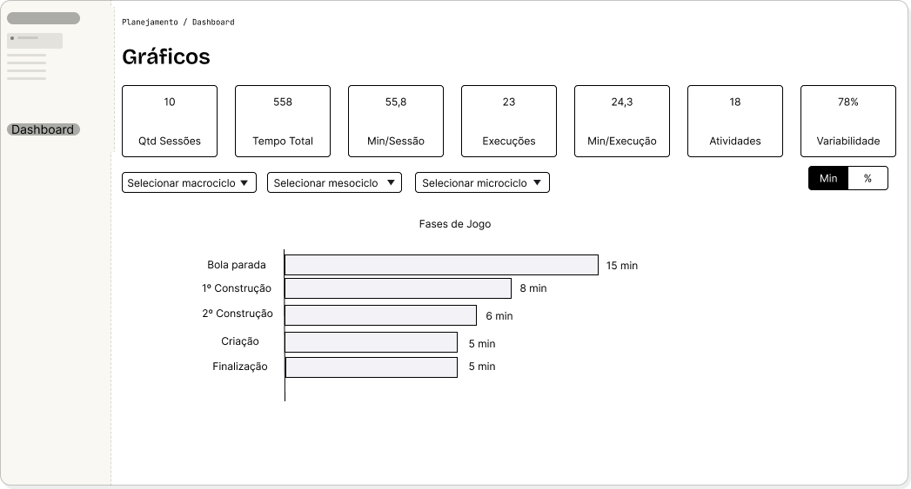
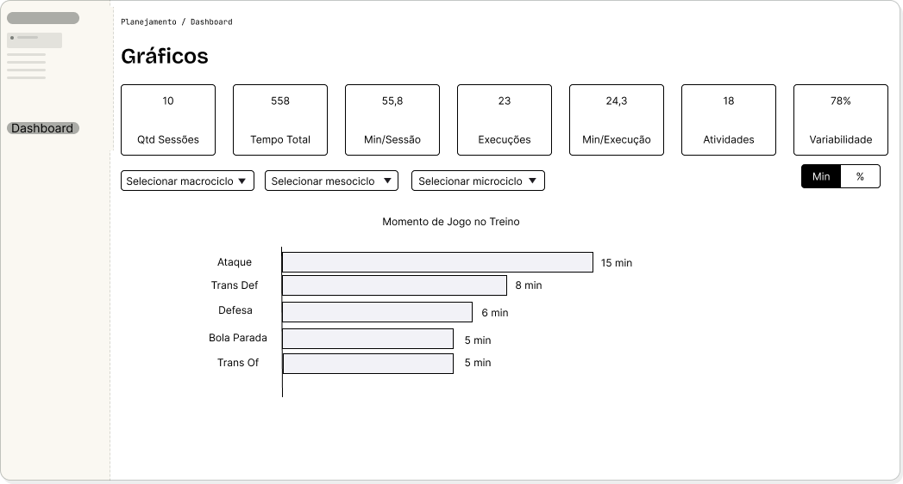

# Evidências — Iteração 11
**Período:** 16/11/2026 a 23/11/2026  
**Histórias trabalhadas:** [US37](../Requisitos-de-Software.md#rf37), [US39](../Requisitos-de-Software.md#rf39), [US40](../Requisitos-de-Software.md#rf40), [US36](../Requisitos-de-Software.md#rf36)

---

## Engenharia de Requisitos { #eng-requisitos }

### Gravações e Atas

| Evidência | Descrição |
| :--- | :--- |
| — | Iteração em andamento (16/11 a 23/11): os protótipos das **US36, US37, US39 e US40** ainda não foram apresentados ao cliente. |

### Protótipos

=== "Baixa Fidelidade"

    === "US37"
        
        *Figura 1: Gráfico de tempo por fase do jogo.*

    === "US39"
        
        *Figura 1: Gráfico de tempo por atributo técnico.*

    === "US40"
        
        *Figura 1: Gráficos comparativos por microciclo, mesociclo, mês e sessão.*

    === "US36"
        
        *Figura 1: Gráfico de tempo por momento do jogo.*

### Registro de Decisões e Matriz de Impacto { #registro-de-decisoes }

Nenhuma decisão registrada nesta iteração até 16/11/2026. A [D10](EV_C4.md#registro-de-decisoes), da Iteração 10, também afeta a US36 e a US37.

---

## Definition of Done { #dod }

### Checklist por História — Iteração 11

=== "US37"

    | Critério do DoD | Evidência | Status |
    | :--- | :--- | :---: |
    | Os critérios de aceitação foram atendidos? | [Issue US37](#) | [] |
    | O código foi integrado na branch main e revisado? | Nenhum PR da US37 integrado até 16/11/2026. | [] |
    | Os workflows de CI/CD do projeto foram executados com sucesso? | O repositório tem apenas o workflow de deploy da documentação ([deploy.yml](https://github.com/mdsreq-fga-unb/REQ-2026.2-T01-FutBoard/blob/main/.github/workflows/deploy.yml)); não há workflow de CI para o código na `main`. | [] |
    | Os testes relacionados foram executados com sucesso? | Nenhum teste da US37 registrado até 16/11/2026. | [] |
    | Os Requisitos Não Funcionais (RNFs) vinculados foram verificados? | Pendente: verificação ainda não registrada (RNF02, RNF04). | [] |
    | A verificação integrada dos fluxos foi realizada com sucesso? | Pendente: verificação ainda não registrada. | [] |
    | A documentação e evidências da entrega estão atualizadas? | Esta página de evidências, atualizada em 16/11/2026. | [] |
    | A funcionalidade da User Story desenvolvida foi validada pelo cliente? | Pendente: protótipo e funcionalidade ainda não apresentados ao cliente. | [] |

=== "US39"

    | Critério do DoD | Evidência | Status |
    | :--- | :--- | :---: |
    | Os critérios de aceitação foram atendidos? | [Issue US39](#) | [] |
    | O código foi integrado na branch main e revisado? | Nenhum PR da US39 integrado até 16/11/2026. | [] |
    | Os workflows de CI/CD do projeto foram executados com sucesso? | O repositório tem apenas o workflow de deploy da documentação ([deploy.yml](https://github.com/mdsreq-fga-unb/REQ-2026.2-T01-FutBoard/blob/main/.github/workflows/deploy.yml)); não há workflow de CI para o código na `main`. | [] |
    | Os testes relacionados foram executados com sucesso? | Nenhum teste da US39 registrado até 16/11/2026. | [] |
    | Os Requisitos Não Funcionais (RNFs) vinculados foram verificados? | Pendente: verificação ainda não registrada (RNF02, RNF04). | [] |
    | A verificação integrada dos fluxos foi realizada com sucesso? | Pendente: verificação ainda não registrada. | [] |
    | A documentação e evidências da entrega estão atualizadas? | Esta página de evidências, atualizada em 16/11/2026. | [] |
    | A funcionalidade da User Story desenvolvida foi validada pelo cliente? | Pendente: protótipo e funcionalidade ainda não apresentados ao cliente. | [] |

=== "US40"

    | Critério do DoD | Evidência | Status |
    | :--- | :--- | :---: |
    | Os critérios de aceitação foram atendidos? | [Issue US40](#) | [] |
    | O código foi integrado na branch main e revisado? | Nenhum PR da US40 integrado até 16/11/2026. | [] |
    | Os workflows de CI/CD do projeto foram executados com sucesso? | O repositório tem apenas o workflow de deploy da documentação ([deploy.yml](https://github.com/mdsreq-fga-unb/REQ-2026.2-T01-FutBoard/blob/main/.github/workflows/deploy.yml)); não há workflow de CI para o código na `main`. | [] |
    | Os testes relacionados foram executados com sucesso? | Nenhum teste da US40 registrado até 16/11/2026. | [] |
    | Os Requisitos Não Funcionais (RNFs) vinculados foram verificados? | Pendente: verificação ainda não registrada (RNF02, RNF04). | [] |
    | A verificação integrada dos fluxos foi realizada com sucesso? | Pendente: verificação ainda não registrada. | [] |
    | A documentação e evidências da entrega estão atualizadas? | Esta página de evidências, atualizada em 16/11/2026. | [] |
    | A funcionalidade da User Story desenvolvida foi validada pelo cliente? | Pendente: protótipo e funcionalidade ainda não apresentados ao cliente. | [] |

=== "US36"

    | Critério do DoD | Evidência | Status |
    | :--- | :--- | :---: |
    | Os critérios de aceitação foram atendidos? | [Issue US36](#) | [] |
    | O código foi integrado na branch main e revisado? | Nenhum PR da US36 integrado até 16/11/2026. | [] |
    | Os workflows de CI/CD do projeto foram executados com sucesso? | O repositório tem apenas o workflow de deploy da documentação ([deploy.yml](https://github.com/mdsreq-fga-unb/REQ-2026.2-T01-FutBoard/blob/main/.github/workflows/deploy.yml)); não há workflow de CI para o código na `main`. | [] |
    | Os testes relacionados foram executados com sucesso? | Nenhum teste da US36 registrado até 16/11/2026. | [] |
    | Os Requisitos Não Funcionais (RNFs) vinculados foram verificados? | Pendente: verificação ainda não registrada (RNF02, RNF04). | [] |
    | A verificação integrada dos fluxos foi realizada com sucesso? | Pendente: verificação ainda não registrada. | [] |
    | A documentação e evidências da entrega estão atualizadas? | Esta página de evidências, atualizada em 16/11/2026. | [] |
    | A funcionalidade da User Story desenvolvida foi validada pelo cliente? | Pendente: protótipo e funcionalidade ainda não apresentados ao cliente. | [] |

