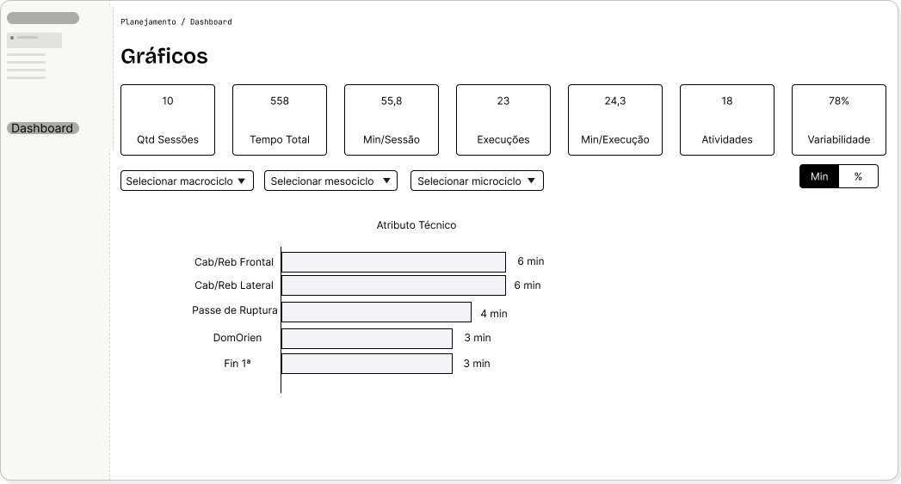
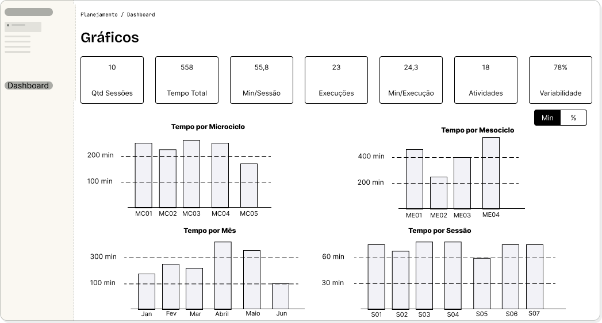

# Evidências — Iteração 11
**Período:** 16/11/2026 a 23/11/2026  
**Histórias trabalhadas:** [US38](../Requisitos-de-Software.md#rf38), [US40](../Requisitos-de-Software.md#rf40), [US41](../Requisitos-de-Software.md#rf41), [US36](../Requisitos-de-Software.md#rf36), [US37](../Requisitos-de-Software.md#rf37)

---

## Engenharia de Requisitos { #eng-requisitos }

### Gravações e Atas

| Evidência | Descrição |
| :--- | :--- |
| — | Iteração em andamento (16/11 a 23/11): os protótipos das **US36, US37, US38, US40 e US41** ainda não foram apresentados ao cliente. |

### Protótipos

=== "Baixa Fidelidade"

    === "US38"
        
        *Figura 1: Gráfico de tempo por fase do jogo.*

    === "US40"
        
        *Figura 1: Gráfico de tempo por atributo técnico.*

    === "US41"
        
        *Figura 1: Gráficos comparativos por microciclo, mesociclo, mês e sessão.*

    === "US36"
        Sem protótipo no Figma até 16/11/2026.

    === "US37"
        
        *Figura 1: Gráfico de tempo por momento do jogo.*

### Confronto Cruzado { #confronto-cruzado }

| História | Item declarado | Evidência no protótipo | Status |
| :--- | :--- | :--- | :---: |
| **US37** | Critérios de aceitação | O [protótipo](../../assets/evidencias/US37_consulta_momento_jogo.png) ainda não foi apresentado ao cliente; os critérios entram na issue da história depois da validação | [] |
| **US38** | Critérios de aceitação | O [protótipo](../../assets/evidencias/US38_consulta_fase_jogo.png) ainda não foi apresentado ao cliente; os critérios entram na issue da história depois da validação | [] |
| **US40** | Critérios de aceitação | O [protótipo](../../assets/evidencias/US40_consulta_atributo_tecnico.png) ainda não foi apresentado ao cliente; os critérios entram na issue da história depois da validação | [] |
| **US41** | Critérios de aceitação | O [protótipo](../../assets/evidencias/US41_analise_comparativa.png) ainda não foi apresentado ao cliente; os critérios entram na issue da história depois da validação | [] |
| **US36** | Critérios de aceitação | Sem protótipo no Figma; os critérios entram na issue da história depois da prototipação e da validação | [] |

**Resultado:** iteração em andamento. Os protótipos ainda não foram apresentados ao cliente; depois da validação, os critérios de aceitação são declarados na issue de cada história e o confronto é feito antes da construção.

### Registro de Decisões e Matriz de Impacto { #registro-de-decisoes }

Nenhuma decisão registrada nesta iteração até 16/11/2026. A [D10](EV_C4.md#registro-de-decisoes), da Iteração 10, também afeta a US37 e a US38.

---

## Definition of Done { #dod }

### Checklist da Iteração 11

| Critério do DoD | Evidência | Status |
| :--- | :--- | :---: |
| Os critérios de aceitação foram atendidos? | [Issue US38](#) [Issue US40](#) [Issue US41](#) [Issue US36](#) [Issue US37](#) | [] |
| O código foi integrado na branch main e revisado? | Nenhum PR das histórias desta iteração até 16/11/2026. | [] |
| Os workflows de CI/CD do projeto foram executados com sucesso? | O repositório tem apenas o workflow de deploy da documentação ([deploy.yml](https://github.com/mdsreq-fga-unb/REQ-2026.2-T01-FutBoard/blob/main/.github/workflows/deploy.yml)); não há workflow de CI para o código. | [] |
| Os testes relacionados foram executados com sucesso? | Nenhum teste das histórias desta iteração até 16/11/2026. | [] |
| Os Requisitos Não Funcionais (RNFs) vinculados foram verificados? | Pendente: verificação ainda não registrada. | [] |
| A verificação integrada dos fluxos foi realizada com sucesso? | Pendente: verificação ainda não registrada. | [] |
| A documentação e evidências da entrega estão atualizadas? | Esta página de evidências, atualizada em 16/11/2026. | [] |
| A funcionalidade da User Story desenvolvida foi validada pelo cliente? | [] [Validação US38](#) [] [Validação US40](#) [] [Validação US41](#) [] [Validação US36](#) [] [Validação US37](#) | [] |

