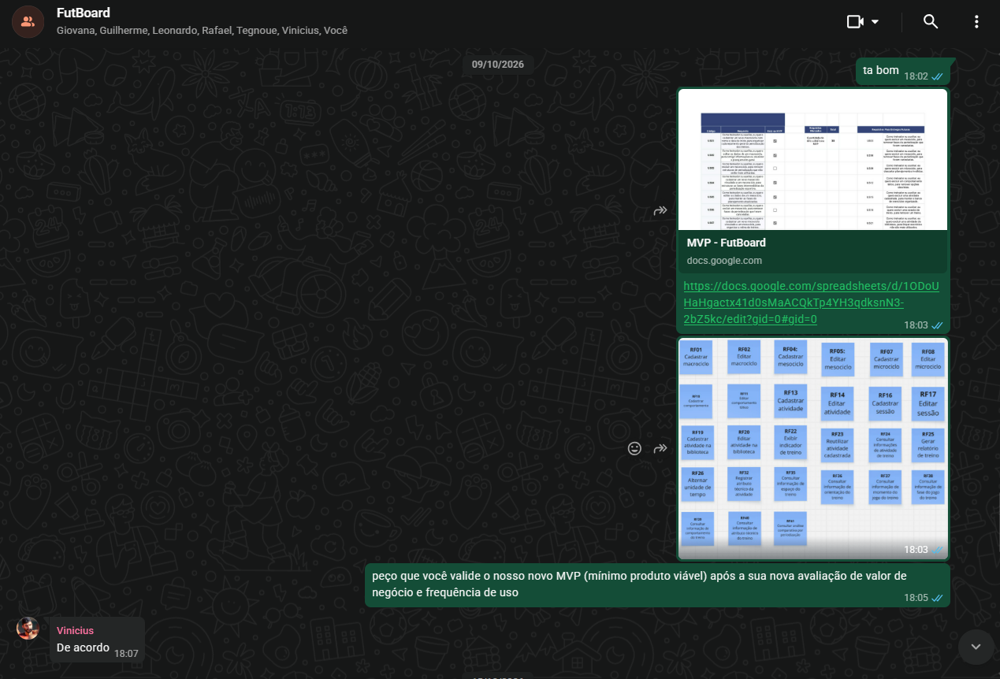

# Validação com o cliente

## Validação do MVP

<figure>
  
  <figcaption>Figura 1: Comprovação de Validação do Cliente sobre o MVP</figcaption>
</figure>

[Voltar para o MVP](backlog_do_produto.md##-10.3-Validação-do-Backlog-e-Escopo-do-MVP-com-o-Cliente)